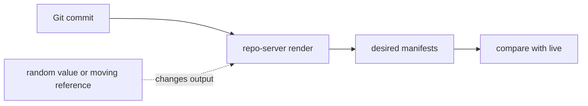

# Repeatable Rendering, Secrets And Reading Errors

An Application is useful only if its desired state is stable. Argo CD renders the inputs again at every refresh and compares the result with the cluster. If the rendering gives a different answer each time, the Application never settles. This part explains what makes rendering repeatable, where secrets must stay out, and how to read the diff when something is wrong.

## Why the same commit must give the same output

Argo CD keeps the desired state in Git. The commit ID names the exact input. The rendering function must depend on that input and on nothing else. Then every refresh of the same commit gives identical manifests, and a difference between desired and live state means a real change in the cluster.

Several things break this rule. A Helm template that calls `randAlphaNum` or `now` produces a new value at each render. Every refresh then shows the object as out of sync. A chart that is fetched by a floating version, such as a range or the newest chart, can change without a Git commit. A Kustomize remote base that points at a branch name instead of a commit or a tag can change in the same way.



The diagram shows the render step as a function of the commit. A random value or a moving reference enters the function from outside and makes the output unstable.

## Make inputs fixed

Pin every input that you do not own. Use an exact chart version in `targetRevision` for a chart from a Helm repository. Use an image tag or, better, an image digest, which is a hash of the image content that cannot change. Reference a remote Kustomize base by a tag or commit ID. Commit the chart dependencies lock file when a chart has dependencies.

For random values that must exist, such as a generated password, let the cluster create them once. Do not generate them in a template. A template that makes a random value at each render is the most common source of an Application that is always out of sync.

Argo CD also has a setting for differences that are not errors. `ignoreDifferences` in the Application tells the comparison to skip given fields. A common use is a field that a controller in the cluster writes, such as the replica count when a HorizontalPodAutoscaler manages it. Use it for fields that another component owns, not to hide an unstable template.

## Try it: see the effect of a moving input

Use the playground to see how the comparison reacts to a change that did not come from Git. The steps need the Application `scout-chart`, which deploys the `chart` directory into `starfleet-staging` with two replicas. Create it first if your playground does not have it.

<!-- astrona:playground:renew -->

Scale the Deployment by hand and read the Application status:

```sh
kubectl -n starfleet-staging scale deploy/scout --replicas=5
kubectl -n argocd get application scout-chart -o jsonpath='{.status.sync.status}'
```

With `automated: {}` and no `selfHeal`, Argo CD reports `OutOfSync` and does not revert the change, because the manual change is a difference between live and desired state, and the Application only syncs on a new Git commit. Run a manual sync with `kubectl -n argocd patch application scout-chart --type merge -p '{"operation":{"sync":{}}}'` and the replica count returns to two.

## Secrets and generation inputs

Values files, parameters, patches and generators are all stored in Git or in an Application. Anyone who can read the repository can read them. A password written into `values.yaml`, into a `valuesObject` or into a Kustomize `secretGenerator` literal is visible to every reader of the repository, and Argo CD shows rendered manifests in its web page and in `argocd app manifests`.

Keep the secret value out of the inputs. Store only a reference, such as the name of a Secret that another component creates, and let the workload read that Secret. If you must keep an encrypted secret in Git, use a tool that decrypts it inside the cluster, not in the Argo CD rendering step.

The people who can edit the inputs also control the workloads. A patch can add a privileged container, and a value can change an image. The permission to merge into the repository is therefore part of the security boundary of the deployment. Protect the branch that Applications follow and require review for changes.

## Read the diff when the result is wrong

When the delivered result is not what you expect, work through the stages in order. This avoids guessing.

1. Identify the exact source: repository URL, revision and path. The Application status shows the resolved commit in `status.sync.revision`.
2. Render the same input yourself with `helm template` or `kubectl kustomize` using the same values and overrides.
3. Read the Application conditions for a `ComparisonError` or an error from the sync operation.
4. Compare the rendered manifests with the live objects, for example with `argocd app diff` or by reading the live object.
5. Only then look at the pods, their events and the business behaviour.

A render that fails shows a comparison error and keeps the last good state. A render that succeeds but produces the wrong object shows no error at all. Only the diff reveals it, so read the diff each time you change an input.

## Try it: read a build error

Break a patch on purpose in a clone of the repository, push it, and read the condition. Change the name in `overlays/staging/message.yaml` from `scout` to `scouts`, then push:

```sh
sed -i.bak 's/name: scout$/name: scouts/' overlays/staging/message.yaml && rm overlays/staging/message.yaml.bak
git add overlays/staging/message.yaml
git commit -m "Break the staging patch"
git push origin main
```

If you have an Application on `overlays/staging`, read its conditions after a refresh:

```sh
kubectl -n argocd annotate application <name> argocd.argoproj.io/refresh=hard --overwrite
kubectl -n argocd get application <name> -o jsonpath='{.status.conditions[*].message}'
```

The message contains the Kustomize error about the missing patch target. The running workloads stay as they were. Revert the commit when you are done.

In this part you saw that repeatable rendering needs fixed inputs, that secrets must stay out of values and patches, and that the stages of rendering, comparison and apply each have their own signs of failure. You can now read the inputs of an Application and predict what it renders.

## Common pitfalls

> [!WARNING]
> Do not use `ignoreDifferences` to hide a template that changes at every render, and do not put a secret into a values file or a generator literal. Pin chart versions, image tags and remote bases, and read the rendered diff after every input change.
