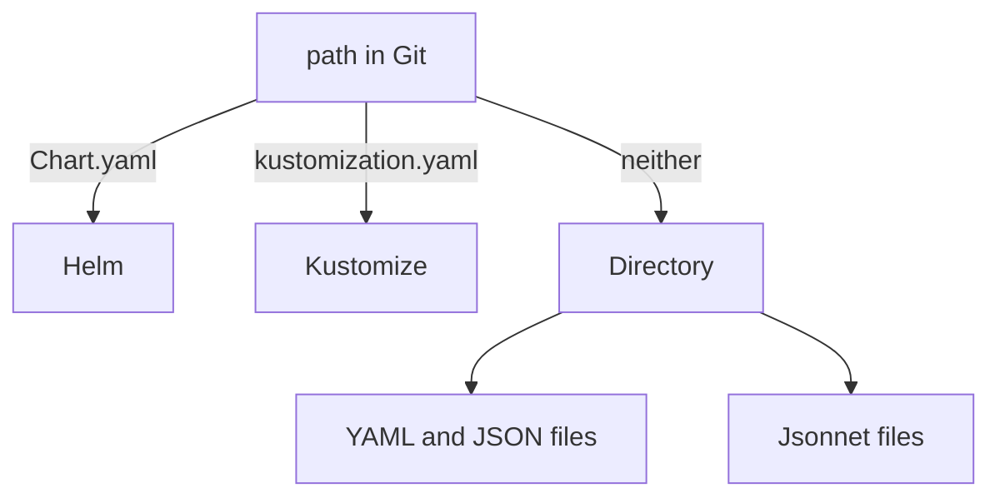

# Directory Sources And Source Type Detection

The simplest desired state is a folder of Kubernetes manifests: YAML or JSON files that describe a Deployment, a Service and the other objects of an application. No template language is involved, so a reviewer reads in Git exactly what the cluster receives. This part explains how Argo CD decides that a path is such a folder, which files it reads, and which settings change that.

## How Argo CD picks a source type

Argo CD does not need to be told which tool to run. The repo-server component looks into the `path` of the Application source and chooses a source type from the files it finds. If the folder has a `Chart.yaml`, the type is Helm. If it has a `kustomization.yaml`, `kustomization.yml` or `Kustomization` file, the type is Kustomize. If it has neither, the type is Directory.

The Directory type is the fallback, and it is also the type that runs Jsonnet. You can force a type by setting one of the tool blocks in `spec.source`, such as `helm`, `kustomize`, `directory` or `plugin`. A forced type matters when a folder holds both a `Chart.yaml` and plain files, because the detection order would otherwise choose Helm.



The diagram shows the detection order and that the Directory type covers both plain files and Jsonnet.

## What a directory source reads

The repo-server reads the files directly inside `path` whose names end in `.yaml`, `.yml`, `.json` or `.jsonnet`. It ignores every other file, such as a `README.md` or a text file. A file can hold several objects separated by a line with `---`. The objects of all files form the desired state.

The repo-server does not look into sub-directories by default. This is the most common surprise with the Directory type: a manifest in `plain/extra/notes.yaml` is simply not part of the Application. Three fields of `spec.source.directory` change this:

- `recurse: true` makes the repo-server read the sub-directories as well.
- `include` is a glob pattern. Only files whose path matches it are read, for example `'*.yaml'`.
- `exclude` is a glob pattern. Files whose path matches it are skipped, for example `'drafts/*'`. A list of patterns uses braces, as in `'{drafts/*,*.test.yaml}'`.

The patterns are matched against the path of the file relative to the `path` of the source. When both `include` and `exclude` are set, a file must match `include` and must not match `exclude`.

## Try it: read a folder with and without recursion

The playground repository has a folder `plain/` with `scout.yaml` (a Deployment and a Service), `extra/notes.yaml` (a ConfigMap named `scout-notes`), `drafts/draft.yaml` (a ConfigMap named `scout-draft`) and a text file `notes.txt`.

<!-- astrona:playground:renew -->

Save this as `application-scout-plain.yaml`:

```yaml
apiVersion: argoproj.io/v1alpha1
kind: Application
metadata:
  name: scout-plain
  namespace: argocd
spec:
  project: default
  source:
    repoURL: http://gitea-http.gitea.svc:3000/starfleet/scout-deploy.git
    targetRevision: main
    path: plain
  destination:
    server: https://kubernetes.default.svc
    namespace: starfleet-staging
  syncPolicy:
    automated: {}
    syncOptions:
      - CreateNamespace=true
```

Apply it:

```sh
kubectl apply -f application-scout-plain.yaml
```

Then check the result:

```sh
kubectl -n starfleet-staging get deploy,svc,configmap
```

The namespace has the Deployment and the Service from `scout.yaml`. It has no `scout-notes`, because that file is in a sub-directory. The text file is not a manifest and Argo CD never reads it.

Now add the `directory` block under `source` in the same file:

```yaml
    directory:
      recurse: true
```

Apply the file again with `kubectl apply -f application-scout-plain.yaml`. After the next refresh, `scout-notes` appears. It appears together with `scout-draft`, because recursion reads every sub-directory. A draft folder in a path that Argo CD syncs is a risk: anything in it is delivered.

Add the exclusion next to `recurse`:

```yaml
      exclude: 'drafts/*'
```

Apply the file once more. With automated sync and no pruning, `scout-draft` stays in the cluster until you delete it, because the default automated policy does not prune. Run `kubectl -n starfleet-staging delete configmap scout-draft` and confirm that Argo CD does not create it again.

## Namespaces and cluster-scoped objects

A directory source applies the objects exactly as written. An object with no `metadata.namespace` goes to the destination namespace of the Application. An object that names a namespace keeps it. Cluster-scoped objects, such as a ClusterRole, ignore the destination namespace.

Because nothing rewrites the files, the same folder cannot serve two environments with different values. Teams that need that either keep one folder per environment, which duplicates files, or move to Helm or Kustomize. Plain directories fit small applications and stable infrastructure objects.

## Checking the folder before Argo CD does

You can test a folder before you push it. `kubectl apply --dry-run=client -f plain/ --recursive` parses every file and reports YAML errors and unknown kinds. Use `--dry-run=server` to ask the API server to validate the objects against the real schemas of the cluster. A broken file makes the whole Application show a comparison error, and Argo CD applies nothing until you fix it.

In this part you saw how Argo CD detects the source type, that a directory source reads only the top level unless `recurse` is set, and that `include` and `exclude` decide which files count. The next question is what to do when the manifests must be computed, not written by hand.

## Common pitfalls

> [!WARNING]
> A manifest in a sub-directory is silently ignored until you set `directory.recurse: true`. The opposite mistake is just as costly: with `recurse` on, every draft or example file in the tree is delivered unless you exclude it. Also remember that a plain directory has no template, so an environment difference means a second copy of the file.
