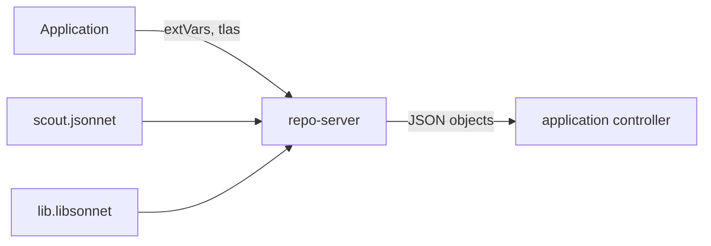

# Jsonnet: Programs That Generate Manifests

A folder of plain manifests repeats itself. Ten services with the same Deployment shape need ten near-identical files, and a change to the shape must be made ten times. Helm solves this with text templates. Jsonnet solves it with a small programming language whose values are JSON objects. This part explains what Jsonnet is, how Argo CD evaluates it, and why the result is repeatable.

## What Jsonnet is

Jsonnet is a data templating language. A Jsonnet program describes a JSON value. It can define local variables, functions and objects, and it can merge two objects. Argo CD embeds the Go implementation, go-jsonnet. A file with the extension `.jsonnet` is a program, and a file with the extension `.libsonnet` is a library that programs import.

The playground repository has two files in `jsonnet/`. The library `lib.libsonnet` defines two functions, `deployment(name, replicas, message)` and `service(name)`, which return Kubernetes objects. The program `scout.jsonnet` imports the library, reads two external variables and returns a list with a Deployment and a Service:

```
local lib = import 'lib.libsonnet';
local replicas = std.parseInt(std.extVar('replicas'));
local message = std.extVar('message');
[
  lib.deployment('scout', replicas, message),
  lib.service('scout'),
]
```

The function `std.extVar` reads an external variable by name. `std.parseInt` turns the string `"2"` into the number `2`. The program does not read files or the network. Its only inputs are the imported files and the variables, so the same inputs always give the same output.

## How Argo CD evaluates a program

The Directory source type runs every `.jsonnet` file in the path. The repo-server evaluates the file and expects a JSON object or a JSON array of objects. It treats each object as a manifest. Library files with `.libsonnet` are not evaluated on their own, because only `.jsonnet`, `.yaml`, `.yml` and `.json` files count as manifest files.

Two kinds of input reach a program. External variables, set under `directory.jsonnet.extVars`, are read with `std.extVar`. Top-level arguments, set under `directory.jsonnet.tlas`, are passed as parameters when the program itself is a function. Each entry has a `name` and a `value`, and `code: true` makes the value evaluated as Jsonnet code instead of a string. A third field, `directory.jsonnet.libs`, lists extra folders of the repository that the importer searches.



The diagram shows that the repo-server combines the program, its library and the variables from the Application, and passes plain objects on.

## Try it: evaluate the program

<!-- astrona:playground:renew -->

Save this as `application-scout-jsonnet.yaml`:

```yaml
apiVersion: argoproj.io/v1alpha1
kind: Application
metadata:
  name: scout-jsonnet
  namespace: argocd
spec:
  project: default
  source:
    repoURL: http://gitea-http.gitea.svc:3000/starfleet/scout-deploy.git
    targetRevision: main
    path: jsonnet
    directory:
      jsonnet:
        extVars:
          - name: replicas
            value: "2"
          - name: message
            value: from-jsonnet
  destination:
    server: https://kubernetes.default.svc
    namespace: starfleet-production
  syncPolicy:
    automated: {}
    syncOptions:
      - CreateNamespace=true
```

Apply it:

```sh
kubectl apply -f application-scout-jsonnet.yaml
```

Then check the result:

```sh
kubectl -n argocd get application scout-jsonnet
kubectl -n starfleet-production get deploy scout -o jsonpath='{.spec.replicas}'
kubectl -n starfleet exec deploy/shuttle -- curl -s http://scout.starfleet-production
```

The Deployment has two replicas and the response of the application carries the message `from-jsonnet`. The `replicas` and `message` values came from the Application, not from Git.

Now remove the `message` entry from the file and apply it again. The program calls `std.extVar('message')`, and the variable no longer exists. Read the condition on the Application:

```sh
kubectl -n argocd get application scout-jsonnet -o jsonpath='{.status.conditions}'
```

The condition has the type `ComparisonError` and a message from the evaluator that names the missing external variable. The live Deployment is not touched, because Argo CD has no new desired state to apply. Add the entry back to repair it.

## Why this output is repeatable

Jsonnet has no clock, no random function and no network access, so the output depends only on the program, its imports and the variables. That makes it safe for GitOps. If the commit and the variables stay the same, the manifests stay the same. A plugin can run any command and use the network. Jsonnet cannot.

The trade-off is the learning cost. Few teams know Jsonnet, and a reviewer must read a program and imagine its output. The risk is a change in a library that silently changes ten services. A good habit is to render the output on the developer machine with the `jsonnet` tool before a merge, and to review the rendered objects.

## Choosing between Jsonnet and the other tools

Jsonnet fits when many objects share a computed structure and the team already writes code for it. Kustomize fits when the base files are plain and only the differences need to change. Helm fits when the package is shared with other people who tune it with values. This part showed the first case. The next part covers the case where none of the built-in tools fits.

## Common pitfalls

> [!WARNING]
> External variables are always strings. Convert numbers with `std.parseInt` or set `code: true`. A missing variable is a comparison error, not a crash: the old objects keep running while the Application stays out of sync. Library files must be in the same folder or in a path listed under `directory.jsonnet.libs`.
