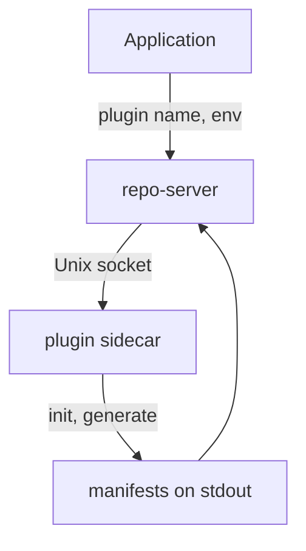

# Config Management Plugins

Helm, Kustomize, Jsonnet and plain directories cover most teams. Some teams generate manifests with another tool: a company-specific generator, `helmfile`, `kustomize` with an unusual flag, or a script that reads a catalog. Argo CD lets them add that tool without changing Argo CD itself. The mechanism is the config management plugin (CMP). This part explains how a plugin runs, what it must produce, and what risk it adds.

## What a config management plugin is

A config management plugin is a program that Argo CD runs to turn the files of a Git path into manifests. The program runs in a sidecar container next to the repo-server container, in the same pod. The sidecar runs a small server, `argocd-cmp-server`, and the repo-server talks to it over a Unix socket in a shared volume. The plugin tool and its dependencies live in the sidecar image, so the repo-server image stays unchanged.

The sidecar needs a plugin definition in the file `/home/argocd/cmp-server/config/plugin.yaml`. The definition is a Kubernetes-style object of the kind `ConfigManagementPlugin`:

```yaml
apiVersion: argoproj.io/v1alpha1
kind: ConfigManagementPlugin
metadata:
  name: scout-generator
spec:
  version: v1.0
  init:
    command: [sh, -c, "echo preparing"]
  generate:
    command: [sh, -c, "cat manifests/*.yaml"]
  discover:
    fileName: "./scout.plugin"
```

The `generate.command` is the one required step. It runs in the directory of the source path and must print valid YAML or JSON manifests to standard output. Anything it prints to standard error is treated as a log. The optional `init.command` runs first, for example to download dependencies. The `discover` block tells Argo CD which paths the plugin can handle, either with `fileName`, `find.glob` or `find.command`.

## How an Application selects a plugin

An Application can name the plugin explicitly. With `spec.source.plugin.name` set to `scout-generator`, Argo CD sends the source to that sidecar. If the name is omitted, Argo CD asks each plugin whose `discover` block matches, and the first match wins. Naming the plugin is the clearer choice, because discovery can change when someone adds a file.

The Application passes input to the plugin as environment variables. Entries under `spec.source.plugin.env` reach the program with the prefix `ARGOCD_ENV_`, so `name: REGION` becomes `ARGOCD_ENV_REGION`. Argo CD also sets build variables such as `ARGOCD_APP_NAME`, `ARGOCD_APP_NAMESPACE`, `ARGOCD_APP_REVISION` and `ARGOCD_APP_SOURCE_PATH`. Plugins can also declare `parameters`, which the Application fills under `spec.source.plugin.parameters`.



The diagram shows that the repo-server hands the source to the sidecar and receives manifests on standard output.

## Sidecar installation

A sidecar plugin is installed by editing the repo-server Deployment. The sidecar container uses the plugin tool image and starts `/var/run/argocd/argocd-cmp-server` as its command. It mounts three volumes: the shared `var-files` volume at `/var/run/argocd`, the `plugins` volume at `/home/argocd/cmp-server/plugins` for the socket, and a ConfigMap with `plugin.yaml` at `/home/argocd/cmp-server/config/plugin.yaml`.

The repo-server pod already has an init container that copies the `argocd-cmp-server` binary into the shared `var-files` volume, so the sidecar only has to start it. The installation is a change to the Deployment of Argo CD, not to the Application repository, and that is the reason many teams use a plugin only when they have to.

## The cost of a plugin

A plugin runs code of your choice inside the repo-server pod with access to the repository content. Several risks follow.

- A plugin that downloads tools or reads the network at generation time can give different output for the same commit. The repeatability that Jsonnet and Kustomize give is gone unless the plugin pins everything.
- A plugin runs with the permissions of its sidecar. A plugin that reads a secret store needs the credentials in the repo-server pod, which many other Applications share.
- A plugin can be slow. Every refresh and every hard refresh runs `generate` again, and the repo-server limits how many manifest generations run in parallel.
- Upgrading Argo CD can break a plugin that relies on the version of an underlying tool. Argo CD 2.8 removed the older plugins that were configured in the `argocd-cm` ConfigMap, and only the sidecar form exists now.

## Try it: look for plugin settings in the playground

The playground has no plugin installed. You can still see how Argo CD would be wired. Look at the containers of the repo-server pod:

<!-- astrona:playground:renew -->

```sh
kubectl -n argocd get deploy argocd-repo-server -o jsonpath='{.spec.template.spec.containers[*].name}'
```

The default installation lists only one container, `argocd-repo-server`. A plugin installation would show a second container. Then list the volumes the pod already shares:

```sh
kubectl -n argocd get deploy argocd-repo-server -o jsonpath='{.spec.template.spec.volumes[*].name}'
```

The list includes `var-files` and `plugins`, which are the volumes a sidecar mounts. Argo CD ships them even without a plugin. The result shows that the repo-server is prepared for plugins, and that adding one is a change to the Deployment of Argo CD, not to the Application repository.

## When not to use a plugin

Before you write a plugin, check whether a built-in tool does the work. Kustomize with a strategic merge patch, Helm with a values file, and Jsonnet with a function cover many generators. If you still need a plugin, keep it small: read files, print manifests, call no network, and pin tool versions in the sidecar image. State the contract in a README in the plugin repository, because the reviewer of an Application change cannot see inside the generator.

In this part you saw that a plugin is a sidecar that prints manifests, that the Application names it and passes `ARGOCD_ENV_` variables, and that it adds risk. The last part compares all formats.

## Common pitfalls

> [!WARNING]
> A plugin `generate` command must print only manifests on standard output. A debug line printed there becomes part of the YAML and breaks the comparison. Also remember that plugins configured through `argocd-cm` no longer work: only the sidecar form is supported.
