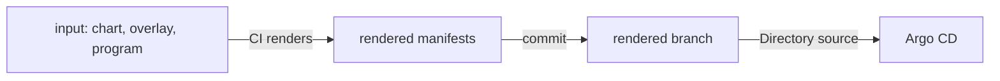

# Choosing A Format And Keeping Output Reviewable

Every format in this module answers the same question: how do the desired manifests get from Git to the cluster, and who can read them on the way. A team that picks a format by habit often pays for it later in review time or in incidents. This part gives the questions that decide the choice and one pattern, rendered manifests, that makes any format reviewable.

## Five formats side by side

The five formats differ in what the author writes, what Argo CD does, and what a reviewer sees.

- Plain directory. The author writes manifests. Argo CD reads the files. The reviewer sees the exact objects. There is no reuse.
- Kustomize. The author writes a base and overlays. Argo CD runs `kustomize build`. The reviewer sees small patches and must imagine the result.
- Helm. The author writes templates and values. Argo CD runs `helm template`. The reviewer sees values and templates and must imagine the result.
- Jsonnet. The author writes a program. Argo CD evaluates it. The reviewer reads code and imagines the result.
- Plugin. The author writes anything. A sidecar runs it. The reviewer sees only what the plugin contract documents.

The further down the list, the more power the author has and the more a reviewer has to infer. A good rule is to choose the least powerful format that removes the duplication you actually have.

## Questions that decide the choice

Ask who consumes the package. If other teams or customers install it, Helm is the common language, because they expect a chart and a values file. If only one team owns the files, a plain directory or Kustomize is enough.

Ask how much differs between environments. If the difference is a replica count, an image tag and a hostname, Kustomize overlays or a few Helm values handle it. If the structure itself differs, such as optional sidecars and generated lists, a program fits better.

Ask how repeatable the output must be. Plain files, Kustomize with local bases, and Jsonnet give the same output for the same commit. Helm gives the same output if the chart version and values are pinned. A plugin gives repeatable output only if its author made it so.

Ask where secrets live. None of these formats should hold a secret value in Git. Choose a format whose output refers to a Secret by name, and fill it with an external secret system or a sealed secret.

## Source type, tool versions and the repo-server

Argo CD 3.5.4 bundles its own versions of Helm, Kustomize and go-jsonnet in the repo-server image. A chart or an overlay that works on the developer machine can render differently on another version of the tool. The practical defense is to render with the same tool version that Argo CD ships, or to pin the version in the Argo CD installation and in the developer instructions.

The repo-server caches the rendered output per commit and source settings in Redis. A change to a value under `helm`, `kustomize` or `directory.jsonnet` in the Application changes the cache key, so the repo-server renders again. A change to a tool version in the repo-server image does not change the cache key for the same commit, so a hard refresh may be needed after an upgrade.

## The rendered manifests pattern

Any format that computes the result hides the result from a reviewer. A pattern called rendered manifests solves this. A CI job renders the manifests and commits the output to a second branch or folder of the repository. Argo CD then syncs the folder of rendered files with the Directory type. A review shows two diffs: the change to the input, and the change to the exact objects.

The pattern has costs. The CI job needs write access to the repository. The rendered branch can drift if someone commits to it by hand. The rendering tool in CI must match the one that people use. Many teams accept these costs for production environments, because the diff of the exact objects is what an auditor wants.



The diagram shows that Argo CD reads the exact objects and the generator runs in CI.

## Try it: see what Argo CD would apply before it applies

You can read the rendered output of any Application without syncing it. The playground has the `argocd` command-line tool as an option. If it is installed, log in and print the manifests of the Application you created earlier:

<!-- astrona:playground:renew -->

```sh
argocd app manifests scout-jsonnet
```

The command prints the objects that the repo-server produced, in the same form that the application controller compares. Compare them with what the Deployment really has:

```sh
kubectl -n starfleet-production get deploy scout -o yaml
```

The live object has extra fields that the Kubernetes API server added, such as defaults and status. The application controller ignores those extra fields when it compares, and it reports a difference only for the fields the manifest sets. If you do not have the `argocd` tool, the web page of the Application shows the desired and the live manifests in its diff view.

## Mixed formats in one repository

A repository can hold several formats at once, one folder per application. The playground repository does this: it has a Kustomize base with overlays, a Helm chart, a plain folder and a Jsonnet program, and each Application points at one path. Argo CD detects the type per path, so the formats do not interfere. The risk is human: a reader who expects Kustomize in every folder will miss that one folder uses a program. A short README in each folder that names the format and the command to render it locally removes that risk.

## Reading an error by format

Each format fails in its own way, and the error appears as a condition on the Application. A plain directory fails with a YAML parse error that names the file. Kustomize fails with a message about a missing resource or a patch target. Helm fails with a template error that names the template and the line. Jsonnet fails with a message that names the file, the line and, for a missing external variable, the variable. A plugin fails with the error output of its `generate` command, which can be empty if the plugin printed nothing. Reading the condition first shows which stage failed before you open any file.

## A reviewable change

When you review a pull request that changes manifest input, look for three things. Check what changed in the rendered output, not only in the input. Check that no secret value or floating version entered the output. Check that the Application settings, such as `recurse`, `exclude` and `extVars`, still select the files you think they do. An Application setting is also part of the desired state, even though it lives in the cluster or in another repository.

Whatever the format, the goal is the same: the person who approves a change must be able to tell what the cluster will receive.

In this part you saw five formats, the questions that choose between them, and the rendered manifests pattern. The summary closes the module.

## What to do when the format must change

Teams sometimes outgrow a format, for example a plain folder that is copied five times. Change the format in a separate commit from any change in behavior. Compare `argocd app manifests` before and after, and require that the two outputs are identical except for the intended differences. A migration with identical output is safe to roll back, and the Application shows no diff after the sync.

## Common pitfalls

> [!WARNING]
> Do not pick Jsonnet or a plugin only because it is more powerful. A reviewer has to read what you write. Also do not assume that a local render equals the Argo CD render: the tool versions can differ. When output must be audited, commit the rendered manifests.
