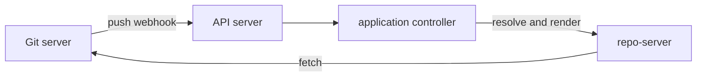

# Fetch Cost, Webhooks And Monorepos

Resolving a revision and fetching its content costs time and load. With a few Applications this does not matter. With hundreds that read one repository, it decides how fast changes arrive and how much the Git server and the Argo CD repo-server suffer. This part explains how Argo CD detects new commits, how it caches results, and how to keep a large repository from causing needless work.

## How a new commit is noticed

Argo CD notices a new commit in one of two ways.

- Polling. The application controller refreshes each Application on an interval, by default three minutes. The setting is `timeout.reconciliation` in the ConfigMap `argocd-cm`. A refresh asks the repo-server to resolve the revision. If the commit is the same as before, the cached manifests are reused.
- Webhooks. The Git server sends an HTTP request to the Argo CD API server at the path `/api/webhook` when a push happens. Argo CD finds the Applications whose source matches the repository and the branch, and refreshes them at once. A webhook shortens the delay from minutes to seconds. It does not replace polling, which stays as the safety net when a delivery is lost.

A webhook can carry a shared secret, set as a key in the Secret `argocd-secret`, so that Argo CD rejects calls that do not come from the Git server.



The diagram shows a push reaching the API server, which triggers a refresh that the repo-server answers from Git.

## What the repo-server caches

The repo-server keeps a local clone of each repository and a cache of rendered manifests, keyed by the repository, the commit and the source settings. The cache lives in Redis. If a refresh finds the same commit, no rendering happens. If it finds a new commit, the repo-server renders again. The settings `reposerver.repo.cache.expiration` and the flag `--parallelismlimit` control how long results stay and how many renders run at once. When many Applications share one commit, the first render fills the cache, and the others reuse it only if their source settings are identical.

## The monorepo problem

In a monorepo, one repository holds the manifests of many services. Every push changes the commit, even if the push touched only one service. By default Argo CD sees a new commit for every Application that uses the repository, and renders them all, although most output is identical.

The annotation `argocd.argoproj.io/manifest-generate-paths` on an Application limits this. It lists paths, separated by semicolons. When a webhook arrives, Argo CD compares the changed files in the push with those paths and skips the refresh if none match. A path starting with `.` is relative to the source path of the Application, and a path starting with `/` is relative to the repository root.

```yaml
metadata:
  annotations:
    argocd.argoproj.io/manifest-generate-paths: .;/shared/base
```

This tells Argo CD that the manifests depend on the source directory itself and on a shared base. The annotation works with webhooks only, because it needs the list of changed files from the push. Polling cannot use it.

## Large repositories and shallow work

Cloning a repository with a long history is slow. The repo-server fetches only what it needs to resolve a revision. Keeping binary files out of the manifest repository, and splitting build output from source, keeps the clone small. Submodules add another fetch for each submodule, and Argo CD does not enable them by default. Setting the environment variable `ARGOCD_GIT_MODULES_ENABLED` to `false` makes that explicit.

## Rate limits and failure

A Git server that is slow or down makes refreshes fail. Argo CD keeps the last good manifests in its cache and shows a comparison error on the Application. The workload keeps running, because Argo CD does not remove anything when it cannot read Git. When Git returns, the next refresh recovers on its own. This is the behaviour to expect, and it is another reason to avoid a single shared Git server with no redundancy.

## Try it: read the refresh settings

Run these commands in the playground:

<!-- astrona:playground:renew -->

```sh
kubectl -n argocd get configmap argocd-cm -o jsonpath='{.data}'
kubectl -n argocd get application -o jsonpath='{range .items[*]}{.metadata.name}{" "}{.status.reconciledAt}{"\n"}{end}'
```

The first command shows whether `timeout.reconciliation` is set. If it is empty, the default of three minutes applies. The second command shows when each Application was last compared. Annotate one Application with `argocd.argoproj.io/refresh=normal` and watch `reconciledAt` change at once, which is the manual form of what a webhook does.

## Common mistakes

- Expecting the manifest-generate-paths annotation to help with polling.
- Setting a very short reconciliation timeout on hundreds of Applications.
- Assuming a Git outage deletes the workload.
- Leaving a webhook without a secret.

## Check yourself

- Which two events cause a refresh of an Application?
- Why does a push to one service refresh every Application in a monorepo by default?
- What does Argo CD do with the cached manifests when Git is unreachable?
