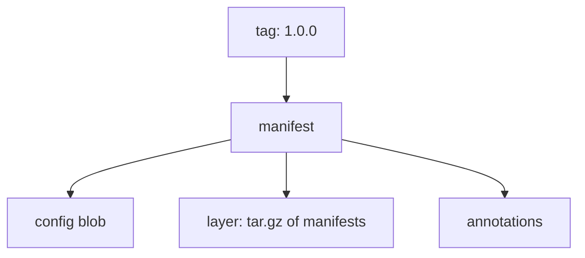

# What An OCI Artifact Is

A state store must give a GitOps engine three things: a way to name a version, a way to fetch exactly that version, and a way to check that the content did not change. Git does this with commits. A container registry does the same with digests. This part explains the structure of an Open Container Initiative (OCI) artifact, which is the unit a registry stores, and shows it in the playground registry.

## From images to artifacts

The OCI defines two specifications that matter here. The image specification describes how a registry stores content. The distribution specification describes the HTTP API that clients use to push and pull it. Registries were built for container images, but the same storage works for any files. An OCI artifact is any content stored this way that is not a runnable image: a Helm chart, a tarball of Kubernetes manifests, a signature.

An artifact has three kinds of parts:

- A manifest. This is a small JSON document. It lists the config and the layers by digest and size, and it carries annotations.
- A config blob. This is a small JSON file that describes the artifact. Its media type tells a client what kind of artifact it is.
- One or more layers. A layer is a blob of bytes, usually a compressed tar archive, that holds the content.

Each part has a media type, a string such as `application/vnd.oci.image.manifest.v1+json`. A client reads the media type to decide how to handle the part. Flux stores manifests as a layer of type `application/vnd.cncf.flux.content.v1.tar+gzip`, with a config of type `application/vnd.cncf.flux.config.v1+json`. Helm charts use their own media types.



The diagram shows that a tag points at a manifest, and the manifest lists the config blob, the layer and the annotations.

## Tags and digests

A tag is a name, such as `1.0.0` or `latest`, that a registry maps to a manifest. A digest is the SHA-256 hash of the manifest, written as `sha256:` followed by 64 hexadecimal characters. A digest identifies content. If a single byte changes, the digest changes.

This is the same split that Git has between a branch or tag and a commit ID. A tag can move: anyone who can push to the repository can point `1.0.0` at a different manifest. A digest cannot move. A client that fetches by digest gets the same bytes every time, and it can verify them by hashing. Because the manifest lists the digests of its blobs, one digest at the top covers the whole artifact.

## Try it: look at the registry

The playground registry has the repository `scout-manifests`. The registry implements the distribution API, so `curl` from the `shuttle` pod can read it. First list the tags:

<!-- astrona:playground:renew -->

```sh
kubectl -n starfleet exec deploy/shuttle -- curl -s http://registry.registry.svc:5000/v2/scout-manifests/tags/list
```

The answer is a JSON document with the repository name and the tags `1.0.0` and `1.1.0`. Now read the manifest of one tag. The `Accept` header asks for the OCI manifest format:

```sh
kubectl -n starfleet exec deploy/shuttle -- curl -s -H "Accept: application/vnd.oci.image.manifest.v1+json" http://registry.registry.svc:5000/v2/scout-manifests/manifests/1.0.0
```

The JSON has a `config` object, a `layers` list with one entry, and an `annotations` object. Each of the first two has a `mediaType`, a `digest` and a `size`. The annotations carry the source and revision text that the push command recorded. Compare the digests of the two tags:

```sh
kubectl -n starfleet exec deploy/shuttle -- curl -sI -H "Accept: application/vnd.oci.image.manifest.v1+json" http://registry.registry.svc:5000/v2/scout-manifests/manifests/1.0.0
```

The response header `Docker-Content-Digest` holds the digest of the manifest. Run the same command for `1.1.0` and compare. The two digests differ, because the two artifacts hold different files.

## Annotations and provenance

The manifest can carry annotations: key and value strings that describe the artifact. The OCI image specification reserves keys with the prefix `org.opencontainers.image`. Three of them matter for state stores: `org.opencontainers.image.source` records where the content came from, `org.opencontainers.image.revision` records the commit or build, and `org.opencontainers.image.created` records the time. The Flux push command sets them from its `--source` and `--revision` options.

These annotations are claims made by whoever pushed. They are useful when they point back to the commit that CI built from, because they let a person trace a running version to its Git history. They are not proof. Anyone with push access can write any text. Proof comes from a signature, which the next parts cover.

## What the artifact contains

The layer is a compressed tar archive of the files that were pushed. For the `scout` artifact, that is a `deployment.yaml` and a `service.yaml`. The archive is the whole payload. Nothing in an artifact says which Kubernetes objects it holds. The consumer decides, for example with a Flux `Kustomization` that reads the unpacked files.

An artifact has no history. A Git repository stores every commit and the parent links between them, so you can ask what changed between two versions. A registry stores independent manifests that happen to have tags. If you need to know why `1.1.0` differs from `1.0.0`, you need a separate record: the annotations on the manifest, a changelog in the artifact, or the commit in Git from which CI built it.

## Registries that exist

Many servers implement the distribution API. Public and private cloud registries do, and so do self-hosted ones such as the reference registry used in the playground, Harbor and Zot. They differ in features that matter for a state store, such as tag immutability, retention rules, replication and signature support, not in the basic push and pull protocol.

## Why a registry as a state store

Several reasons lead teams to a registry. The cluster often already trusts the registry and has network access to it, while access to the Git server may be restricted. A registry stores immutable, content-addressed objects that are cheap to fetch, and a pull does not clone history. Signing tools such as cosign work on OCI content, so the same signing and verification flow covers images and manifests. And a CI system can publish exactly the build that passed its checks.

The cost is that the registry is a second source of truth next to Git. The desired state is now in two places, and the artifact must be built from the repository content by a trusted job. Reading these facts together gives the model for the rest of the module. The registry holds content-addressed objects, tags are movable names, the digest is the identifier, and trust comes from who is allowed to push.

In this part you saw the structure of an artifact and the difference between a tag and a digest. The next part shows how Flux fetches one.

## Reading a digest

A full reference to an artifact by digest has the repository address, then `@`, then the digest. The same text works in a Flux `OCIRepository` and in tools that pull artifacts. Copy digests from a status field or a registry response, never retype them, because a single wrong character names a different object.

## Common pitfalls

> [!WARNING]
> A tag is a name, not a version of the content. Do not treat `1.0.0` as proof of the bytes unless the registry forbids overwriting tags. A digest is the identifier that cannot be changed. Also do not expect history in a registry: it keeps manifests, not the reason for a change.
