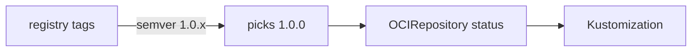

# Flux OCIRepository: Tags, Semantic Versions And Digests

Flux separates fetching from applying. The source controller fetches content from a store and publishes it inside the cluster as an artifact. Other controllers then use that artifact. For Git the source object is a `GitRepository`. For an OCI registry it is an `OCIRepository`. This part explains the fields of an `OCIRepository` and how its reference decides which artifact the cluster follows.

## The OCIRepository object

An `OCIRepository` is a custom resource of the group `source.toolkit.fluxcd.io`. The version `v1` is the stable one in Flux 2.9. The fields that matter are:

- `spec.url` is the address of the repository, written with the scheme `oci://`, for example `oci://registry.registry.svc:5000/scout-manifests`. It has no tag.
- `spec.ref` selects the version. It can hold `tag`, `semver`, `semverFilter` or `digest`.
- `spec.interval` is how often the source controller asks the registry whether the reference points at new content.
- `spec.insecure` allows plain HTTP. It is needed for the playground registry and for no production registry.
- `spec.secretRef`, `spec.serviceAccountName` and `spec.provider` give credentials. The provider field selects cloud authentication for `aws`, `azure` or `gcp`.
- `spec.layerSelector` chooses which layer to unpack, by media type, and whether to extract it or copy it as is.
- `spec.verify` asks the source controller to verify a signature before it accepts the artifact.

The source controller pulls the artifact, unpacks the layer, stores the files as a tarball it serves inside the cluster, and records the result in `status.artifact`. A Kustomization or HelmRelease refers to the `OCIRepository` and reads that stored tarball. They never talk to the registry.

## Choosing the reference

The `ref` decides what the cluster follows, and it is the same decision as the target revision of an Argo CD Application.

With `tag: 1.0.0`, the controller resolves the tag to a digest at every interval. If someone moves the tag, the cluster follows. With `semver: ">=1.0.0 <2.0.0"`, the controller lists the tags, keeps those that parse as semantic versions, and picks the highest one in the range. A new tag `1.4.0` is picked up without a change in the cluster. With `semver: 1.0.x`, only the `1.0` line moves. With `digest: sha256:...`, the controller fetches exactly that manifest. Nothing moves until a person edits the object.

The `semverFilter` field is a regular expression that selects which tags are even considered, which matters when tags carry a prefix or suffix, such as `build-1.2.3` or `1.2.3-rc.1`. The filter applies before the range.



The diagram shows the range selecting one tag, the source controller recording it, and the Kustomization reading that record.

## Reading the status

The status holds the answer. `status.artifact.revision` has the form `<tag>@<digest>`, for example the tag `1.0.0` followed by `@sha256:` and the digest. The part before the `@` is the tag the reference selected, and the part after is the content. The `Ready` condition says whether the last fetch worked. `status.artifact.digest` is the checksum of the tarball that the controller stored, which is not the digest of the registry manifest.

A Kustomization that reads the source reports `status.lastAppliedRevision` in the same form. If the source reports `1.1.0@sha256:...` and the Kustomization reports `1.0.0@sha256:...`, the Kustomization has not yet applied the new artifact. Comparing the two fields is the first check when a release does not arrive.

## Try it: follow a range

Save this as `ocirepository-scout-oci.yaml`:

<!-- astrona:playground:renew -->

```yaml
apiVersion: source.toolkit.fluxcd.io/v1
kind: OCIRepository
metadata:
  name: scout-oci
  namespace: flux-system
spec:
  interval: 1m
  url: oci://registry.registry.svc:5000/scout-manifests
  insecure: true
  ref:
    semver: ">=1.0.0"
```

Apply it:

```sh
kubectl apply -f ocirepository-scout-oci.yaml
```

Then check the result:

```sh
kubectl -n flux-system get ocirepository scout-oci
kubectl -n flux-system get ocirepository scout-oci -o jsonpath='{.status.artifact.revision}'
```

The range `>=1.0.0` includes both tags, so the controller picks the highest, `1.1.0`. The revision starts with `1.1.0@sha256:`. Now change `semver` in the file to `1.0.x` and apply it again. After the next reconcile the revision starts with `1.0.0@sha256:`. To skip the wait, ask for an immediate reconcile:

```sh
kubectl -n flux-system annotate --overwrite ocirepository scout-oci reconcile.fluxcd.io/requestedAt="$(date +%s)"
```

Next, remove the line `insecure: true`, apply the file, and read the `Ready` message:

```sh
kubectl -n flux-system get ocirepository scout-oci -o jsonpath='{.status.conditions[?(@.type=="Ready")].message}'
```

The message reports a connection or protocol error, because the controller now tries HTTPS and the registry speaks plain HTTP. The last good artifact stays available to other controllers, so a Kustomization that reads the source keeps its last applied revision. Restore `insecure: true` before you continue.

## Applying the artifact

A source alone changes nothing in the cluster. A Flux Kustomization applies it. Its `sourceRef` has `kind: OCIRepository` and the name of the source, and its `path` is relative to the root of the unpacked artifact. An artifact without a `kustomization.yaml` gets one generated from the files that are present, the same as in a Git path. The lab after this part builds both objects.

In this part you saw how the fields of `spec.ref` decide what the cluster follows, and how to compare the revision of the source with the revision that was applied. The next question is how artifacts get into the registry and how long they stay.

## Common pitfalls

> [!WARNING]
> A `semver` range selects the highest matching tag, so a new tag changes production without any change in the cluster. For a production environment use a narrow range or a digest. Also remember that `insecure: true` turns off transport security, and that the revision string contains the digest after the `@`, not a Git commit.
