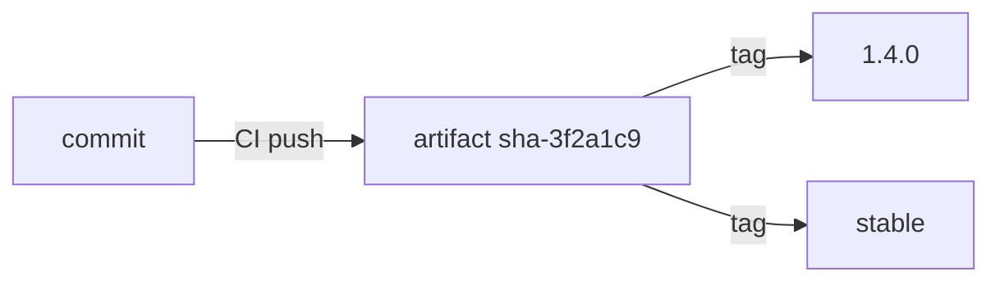

# Publishing, Tagging And Retention

An OCI store only works if something puts correct artifacts into it. In a Git store a person commits and pushes. In an OCI store a pipeline builds an artifact from a commit and pushes it. This part explains the publishing steps, what tagging policies mean for the consumer, and how retention can remove a version that a cluster still needs.

## Publishing with the Flux command-line tool

The `flux` command-line tool has three commands for artifacts. `flux push artifact` packs a local folder into an artifact and pushes it. `flux tag artifact` adds a tag to an existing artifact without pushing content again. `flux pull artifact` downloads an artifact and unpacks it, which lets a person inspect what the cluster received. A fourth command, `flux list artifacts`, shows the tags of a repository.

The playground registry was filled with the same command, run in a Job:

```
flux push artifact oci://registry.registry.svc:5000/scout-manifests:1.0.0 \
  --path=./manifests \
  --source="$(git config --get remote.origin.url)" \
  --revision="1.0.0@sha1:$(git rev-parse HEAD)"
```

The `--path` option names the folder to pack. The `--source` and `--revision` options become the annotations that tie the artifact to a commit. A registry with plain HTTP also needs `--insecure-registry`. Other tools do the same job: `oras push` and the Helm command `helm push` for charts, and the Argo CD ecosystem uses the same registry protocol with its own tools.

The step belongs in CI, after the checks pass and after a reviewer merged the change. The pipeline reads the commit, builds the artifact, pushes it, and optionally signs it. The cluster credentials stay out of the pipeline, because the cluster pulls.

## Tagging policies

A tag policy is a rule for which tags exist and what each one means. Three policies are common.

- Immutable version tags. Each release gets a new tag such as `1.4.0`, and the registry rejects pushes to an existing tag. Consumers can follow a semantic version range and know that a given tag always means the same bytes.
- A moving tag such as `latest` or `stable`. The pipeline moves it on every release. A consumer that follows the tag changes whenever the pipeline moves it. This is convenient and hard to audit.
- Commit tags such as `sha-3f2a1c9`. The tag is the commit ID. Consumers cannot use a semantic version range, but the tag links the artifact to one commit.

Many teams combine them: push the artifact with the commit tag, then add the version tag with `flux tag artifact` when the release is approved. The artifact is the same content with two names. Both tags resolve to the same digest, and a consumer that needs strong evidence follows the digest.



The diagram shows one artifact with three names. Only the first name ties it to a commit.

## Try it: tags and digests in the playground

Both tags in the playground registry were pushed by separate commands, so they point at different manifests. Save this as `ocirepository-scout-tag.yaml`:

<!-- astrona:playground:renew -->

```yaml
apiVersion: source.toolkit.fluxcd.io/v1
kind: OCIRepository
metadata:
  name: scout-tag
  namespace: flux-system
spec:
  interval: 1m
  url: oci://registry.registry.svc:5000/scout-manifests
  insecure: true
  ref:
    tag: 1.0.0
```

Apply it:

```sh
kubectl apply -f ocirepository-scout-tag.yaml
```

Then read the revision, which holds the digest after the `@`:

```sh
kubectl -n flux-system get ocirepository scout-tag -o jsonpath='{.status.artifact.revision}'
```

Copy the digest from that output. Edit the file and replace the `tag` line with a `digest` line that holds the full `sha256:` value, then apply the file again. The `Ready` condition stays true and the revision keeps the same digest. From now on the object follows content, not a name. If somebody moved the tag `1.0.0` to a new manifest, the tag-based object would change at the next interval and the digest-based object would not.

## Retention

A registry keeps what it is told to keep. Some registries delete untagged manifests after a time, and some delete old tags by a policy such as keeping the newest ten. Both rules can remove a version that a cluster still uses or that you need for a rollback.

The failure has a precise shape. A cluster that already applied `1.0.0` keeps running even after the registry deletes it, because the objects are already in the cluster. The next fetch of the source fails, the `Ready` condition becomes false, and the Kustomization keeps its last applied state. A rollback to `1.0.0` then fails, because the artifact no longer exists. In a Git store, old commits stay as long as a branch or tag reaches them, so the rollback target survives.

Therefore a team that uses a registry as its state store defines retention on purpose. Keep every tag that was ever released to production, keep untagged manifests that a digest reference points at, and back the registry up like the Git server.

## Immutability and who may push

Two registry settings protect the consumer. Tag immutability stops a push to an existing tag. Push permissions limit who can add or move tags. A pipeline identity with push access to the `scout-manifests` repository is as powerful as a developer with write access to the main branch of a Git repository, because the cluster follows what it pushes. Give the pipeline push access to the repository it builds, and give the cluster pull access only.

In this part you saw how artifacts get published, how tag policies change what a consumer follows, and why retention is part of the design. The last part moves to Argo CD and compares Git with a registry as a whole.

## Common pitfalls

> [!WARNING]
> Do not allow a moving tag to be the only reference of a production environment. The cluster changes when the pipeline moves the tag, and the registry has no record of what the tag pointed at before. Also check the retention policy of the registry before you rely on it for rollbacks.
