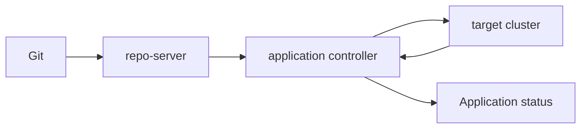

# Argo CD Components And The Reconciliation Loop

A reconciliation engine repeats one loop: read the desired state, read the live state, find the difference, and remove it. Argo CD runs this loop as several cooperating components. This part names the components, follows one refresh from Git to the cluster, and shows where each status field comes from.

## The components

The API server serves the web page, the command-line tool and the Kubernetes API that works on Application objects. It checks permissions and stores nothing important itself.

The repo-server fetches the Git repository, keeps a local copy and renders the manifests for an Application. It runs Helm or Kustomize when the source needs it. The repo-server does not talk to the target cluster. This separation means the part that handles untrusted repository content has no cluster credentials.

The application controller is the reconciler. It watches the live objects in the target cluster, asks the repo-server for the desired manifests, compares the two, and applies the difference when a sync is allowed. It also writes the result to the Application status.

Redis holds a cache of the repository state and of the cluster objects so that the components do not repeat expensive work. Argo CD can run with extra parts, such as an ApplicationSet controller, Dex for single sign-on and a notifications controller. They are not needed for the loop. In the playground, Dex and the notifications controller are scaled to zero.



The diagram shows the loop. Desired manifests flow from Git through the repo-server to the controller. Live state flows back from the cluster to the controller. The controller writes the comparison result to the Application.

## One refresh

A refresh starts the loop for one Application. It starts by interval, about every three minutes, by a webhook from the Git host, or by a person. The repo-server resolves `targetRevision` to a commit, renders the manifests and returns them. The controller loads the live objects from its cache of the cluster and compares them with the rendered ones.

A normal refresh can use cached manifests when the commit did not change. A hard refresh drops the cached manifests and renders again. A person asks for it with the annotation `argocd.argoproj.io/refresh: hard` on the Application.

The comparison covers the fields that the rendered manifest sets. Fields that only the cluster sets, such as defaulted values and status, are not a difference. A field that another controller changes on purpose can be excluded with `ignoreDifferences`.

## Two statuses and one operation

The sync status, `status.sync.status`, answers whether the live objects equal the desired state. The values are `Synced`, `OutOfSync` and `Unknown`. The health status, `status.health.status`, answers whether the objects work. The values include `Healthy`, `Progressing`, `Degraded`, `Suspended`, `Missing` and `Unknown`.

The two are independent. An Application can be `Synced` and `Degraded` when the manifests were applied exactly and the pods crash. It can be `OutOfSync` and `Healthy` when a person changed a Deployment that still works.

A sync is an operation. The controller records it in `status.operationState`, with a phase such as `Running`, `Succeeded` or `Failed`, a message, and the commit that it applied. If the operation fails, the message holds the reason, and `status.conditions` can hold errors such as `ComparisonError` for a render failure.

## Try it: sync by hand

Use the playground to run the loop without a sync policy. The repository has the overlay `overlays/staging`.

<!-- astrona:playground:renew -->

Save this as `application-scout.yaml`:

```yaml
apiVersion: argoproj.io/v1alpha1
kind: Application
metadata:
  name: scout
  namespace: argocd
spec:
  project: default
  source:
    repoURL: http://gitea-http.gitea.svc:3000/starfleet/scout-deploy.git
    targetRevision: main
    path: overlays/staging
  destination:
    server: https://kubernetes.default.svc
    namespace: starfleet-staging
```

Apply it and read the statuses:

```sh
kubectl apply -f application-scout.yaml
kubectl -n argocd get application scout -o jsonpath='{.status.sync.status}{"\n"}{.status.health.status}{"\n"}'
```

The sync status is `OutOfSync` and the health is `Missing`. Argo CD compared the desired state with the cluster, found that nothing exists, and stopped, because the Application has no sync policy. Start a sync by writing an operation into the Application:

```sh
kubectl -n argocd patch application scout --type merge -p '{"operation":{"sync":{"syncOptions":["CreateNamespace=true"]}}}'
kubectl -n argocd wait --for=jsonpath='{.status.sync.status}'=Synced application/scout --timeout=240s
kubectl -n argocd get application scout -o jsonpath='{.status.operationState.phase}{"\n"}'
```

The operation phase is `Succeeded`. The option `CreateNamespace=true` made the controller create the namespace before it applied the objects. A sync started with the command-line tool or the web page writes the same operation.

## What the controller owns

The controller marks every object it applies with the annotation `argocd.argoproj.io/tracking-id`. The value holds the Application name and the identity of the object. This is how Argo CD knows which live objects belong to which Application, and it is how prune finds objects to remove.

Read the annotation on the Deployment:

```sh
kubectl -n starfleet-staging get deploy scout -o jsonpath='{.metadata.annotations.argocd\.argoproj\.io/tracking-id}'
```

An object that carries the annotation of another Application is a conflict, and Argo CD reports a shared-resource warning. Two Applications must not own the same object.

## What the loop does not do

The loop does not run tests and does not judge whether the change is wise. It makes the cluster equal to Git for the objects it manages. It does not manage objects that are not in the rendered manifests and have no tracking annotation. It also does not repeat a failed sync forever.

## Common pitfalls

> [!WARNING]
> A green `Synced` status does not mean the workload works, and a `Healthy` status does not mean the cluster equals Git. Read both statuses and the operation state. An Application without a sync policy reports a difference and then waits for a person.
