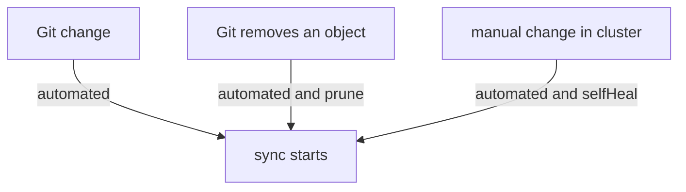

# Sync Policy: Automated Sync, Prune And Self-Heal

The reconciliation loop always compares. Whether it also changes the cluster is decided by the sync policy of the Application. This part explains the three settings that matter most, what each one reacts to, and the sync options that change how objects are applied.

## Manual and automated sync

Without `syncPolicy.automated`, the controller only reports. A person starts every sync. This is a deliberate choice for environments where a human approves each change.

With `syncPolicy.automated`, the controller starts a sync by itself when the Application is `OutOfSync` because Git changed. The trigger is a new desired state. The controller does not start a sync for every refresh, only when the comparison finds a difference that a sync can fix.

Two protections limit the automation. First, a sync that failed is not started again for the same commit and the same parameters. Without a retry setting, the Application stays failed until a new commit arrives or a person starts a sync. Second, the setting `allowEmpty` is off by default, so a render that produces no objects does not make the controller delete everything.

## Prune

By default an automated sync creates and updates objects, and it does not delete. When someone removes a manifest from Git, the live object stays. The Application is then `OutOfSync` with the object marked as requiring pruning.

`prune: true` lets the automated sync delete the objects that carry the tracking annotation of the Application and are no longer in the rendered manifests. Pruning is limited to objects that Argo CD tracks. It does not delete other objects in the namespace.

A single object can opt out with the sync option annotation `argocd.argoproj.io/sync-options: Prune=false`. The sync option `PruneLast=true` makes pruning happen after the other objects are healthy, which helps when the replacement must be running before the old object disappears.

## Self-heal

Prune and automated sync react to changes in Git. Self-heal reacts to changes in the cluster. With `selfHeal: true`, the controller notices that a live object differs from the desired state, for example after `kubectl scale`, and starts a sync that sets it back. Without it, the Application becomes `OutOfSync` and stays that way, and the manual change remains.



The diagram shows what each setting adds. Automated sync reacts to a Git change. Prune adds the removal of objects. Self-heal adds the reaction to the cluster.

Self-heal has a short delay and a back-off between attempts, so a change that is reverted at once by another controller does not cause a tight loop. It is not a replacement for access control. Anyone who can change objects in the cluster can still change them for a moment, and the audit record of the cluster shows the change.

## Sync options

Sync options change how the controller applies objects. They are a list of strings in `syncPolicy.syncOptions`.

- `CreateNamespace=true` creates the destination namespace if it does not exist. Without it, the sync fails when the namespace is missing.
- `ServerSideApply=true` applies with server-side apply, which helps with large objects and with fields shared with other controllers.
- `ApplyOutOfSyncOnly=true` applies only the objects that differ, which reduces load for big Applications.
- `Validate=false` skips client-side validation. Use it only for a known reason.
- `PruneLast=true` prunes after the other objects are healthy.

A retry policy under `syncPolicy.retry` repeats failed syncs. It sets a `limit` and a back-off with `duration`, `factor` and `maxDuration`. It is useful for a failure that clears by itself, such as an object that depends on another that is still starting.

## Try it: add each setting and see what changes

Start from the Application `scout` with no policy. Create it if your playground does not have it: an Application on `main`, path `overlays/staging`, destination namespace `starfleet-staging`, with no sync policy. Sync it once with the option `CreateNamespace=true`.

<!-- astrona:playground:renew -->

Scale the Deployment by hand and read the sync status:

```sh
kubectl -n starfleet-staging scale deploy/scout --replicas=3
kubectl -n argocd get application scout -o jsonpath='{.status.sync.status}{"\n"}'
```

The status becomes `OutOfSync` and the replicas stay at 3, because no policy reacts. Turn on automated sync only:

```sh
kubectl -n argocd patch application scout --type merge -p '{"spec":{"syncPolicy":{"automated":{}}}}'
kubectl -n starfleet-staging get deploy scout -o jsonpath='{.spec.replicas}{"\n"}'
```

Automated sync starts a sync, because the Application is `OutOfSync`, and the replicas go back to 1. Argo CD treats an out-of-sync object as a difference to remove when it starts the sync. Now scale again:

```sh
kubectl -n starfleet-staging scale deploy/scout --replicas=3
kubectl -n starfleet-staging get deploy scout -o jsonpath='{.spec.replicas}{"\n"}'
```

The replicas stay at 3 until a new commit or a manual sync, because only a Git change triggers an automated sync. Add self-heal:

```sh
kubectl -n argocd patch application scout --type merge -p '{"spec":{"syncPolicy":{"automated":{"selfHeal":true}}}}'
```

After a short wait the replicas return to 1 without a commit. The cluster change was the trigger.

## Choosing a policy

A development environment often uses automated sync with prune and self-heal, so Git is the only way to change it. A production environment may use automated sync without self-heal, so an operator can make an emergency change and then record it in Git, or it may use manual sync to keep a human approval step. The choice is a decision about who may change the cluster and when, not a technical default.

## Common pitfalls

> [!WARNING]
> Automated sync does not delete objects and does not revert manual edits. Prune and self-heal are separate settings, and both are off by default. Turning on prune can delete real objects when a manifest is removed or a path is wrong, so check the diff of the Application before you enable it.
