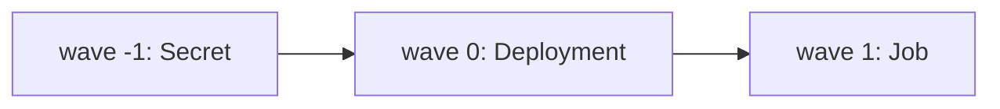

# Sync Order, Health And Deleting Applications

A sync applies many objects, and some must exist before others. Argo CD has rules for the order, it judges the health of what it applied, and it has a rule for what happens when the Application itself is deleted. This part explains all three.

## Default order

Within one sync, Argo CD sorts the objects by kind. Namespaces come first, then objects such as ConfigMaps, Secrets and ServiceAccounts, then workloads and Services, and objects such as webhooks and custom resources later. A custom resource whose definition is in the same sync can therefore be applied after its definition.

The default order only knows kinds. It does not know that your Job needs a database Service to be ready. For that you set the order yourself.

## Sync waves

A sync wave is an integer in the annotation `argocd.argoproj.io/sync-wave`. The default is 0. Objects are applied in ascending wave order, and negative numbers are allowed. Argo CD applies one wave, waits until the objects of that wave are healthy, and then starts the next.

The wait is what makes waves useful. An object in wave 0 that needs a Secret from wave -1 can rely on the Secret existing. If an object in a wave never becomes healthy, the sync stops at that wave and the later waves are not applied.



The diagram shows three waves. Each starts after the previous one is healthy.

## Hooks

A hook is an object that runs at a point of the sync, usually a Job. The annotation `argocd.argoproj.io/hook` names the point: `PreSync` runs before the manifests are applied, `Sync` runs with them, `PostSync` runs after all objects are healthy, and `SyncFail` runs when the sync fails. A `PreSync` job is a common place for a database migration. If the hook fails, the sync stops.

The annotation `argocd.argoproj.io/hook-delete-policy` says when the hook object is removed. `HookSucceeded` deletes it after success, `HookFailed` after failure, and `BeforeHookCreation`, the default, removes the old one before the next run creates a new one. Hooks follow the wave order inside their phase.

## Health assessment

Argo CD judges the health of an object with built-in rules per kind. A Deployment is healthy when its rollout is complete and the updated replicas are available. A Service of type `LoadBalancer` is healthy when it has an address. A Job is healthy when it completes. For a custom resource Argo CD has no rule unless one is added as a Lua script in the configuration, and then the object is treated as healthy once it exists.

The health of the Application is the worst health among its objects, in the order `Healthy`, `Progressing`, `Degraded`. A `Progressing` Application is not an error. It means that the rollout is not finished. Argo CD does not time out a rollout on its own, so a Deployment that cannot start its pods stays `Progressing` until Kubernetes reports the progress deadline as exceeded, after which it is `Degraded`.

## Try it: read the order and the health

Use the playground to read the result of a sync.

<!-- astrona:playground:renew -->

Make sure the Application `scout` exists and is synced. Then read the operation result and the resources that it applied:

```sh
kubectl -n argocd get application scout -o jsonpath='{range .status.resources[*]}{.kind}{" "}{.name}{" "}{.status}{" "}{.health.status}{"\n"}{end}'
kubectl -n argocd get application scout -o jsonpath='{.status.operationState.syncResult.resources[*].syncPhase}{"\n"}'
```

The first command lists each object with its sync status and health. The second lists the phase of each synced object. Both use the fields that the controller wrote when it finished the operation.

Add a wave to see the order. Edit the base copy of the Service in a local clone, add the annotation `argocd.argoproj.io/sync-wave: "1"`, push it, and sync. The Deployment has the default wave 0, so it is applied and healthy first, and the Service follows in wave 1.

## Deleting an Application

Deleting an Application object does not delete its objects by default. The Application is only the record of the relationship. The objects stay in the cluster, but nothing manages them any more.

To make the deletion cascade, the Application carries the finalizer `resources-finalizer.argocd.argoproj.io` in `metadata.finalizers`. A finalizer is a name that blocks the removal of an object until a controller finishes its cleanup. With the finalizer, the controller deletes all tracked objects first and then lets the Application go. The command-line tool and the web page ask whether the deletion should cascade, and add the finalizer for you.

This setting decides the blast radius of a delete. An Application that deploys a namespace with its data can destroy the data when it is deleted with the finalizer, and prune can do the same. Use `Prune=false` and `Delete=false` sync options on objects that must survive, such as a namespace that holds persistent data.

## Differences that are expected

Some fields change in the cluster by design. A HorizontalPodAutoscaler changes the replica count of a Deployment, and an admission webhook can add a sidecar container. If Git sets the same fields, the comparison reports a difference at every refresh, and with self-heal the two controllers fight over the value.

The setting `ignoreDifferences` in the Application names the fields to leave out of the comparison. Each entry has a group, a kind and a JSON pointer such as `/spec/replicas`. With the sync option `RespectIgnoreDifferences=true`, the sync also leaves those fields as they are, instead of overwriting them. Use this for fields that another component owns, and not to hide a real change.

## Reading a stuck sync

A sync that does not finish needs a short check in a fixed order. First read `status.operationState.message`, which says whether the controller is waiting or has failed. Then read `status.resources` to find the object whose health is not `Healthy`. Then read that object in the cluster, its events and its pod logs. The controller is rarely the cause. It reports what the API server and the workloads do.

## Failure of a sync

When a sync fails, the operation phase is `Failed` or `Error`, and the message gives the reason. Common causes are an object that the API server refuses, a missing namespace, a hook that fails and a wave that never becomes healthy. Without a retry policy the controller does not try the same commit again. A person reads the message, fixes the cause in Git, and a new commit triggers the next automated sync.

## Putting the stages together

A change in Git passes through stages, and each stage has its own evidence. The repo-server resolves the commit and renders the manifests, and a failure shows as a `ComparisonError`. The controller compares and starts a sync, and the sync status and the operation state show the result. The API server of the target cluster accepts or refuses each object, and a refusal appears in the operation message. The workloads start, and the health status shows whether they work.

When you read an incident, name the stage first. A pod that crashes is a workload problem even though the Application looks red. A refused object is a manifest problem even though Git is correct. Naming the stage keeps you from changing the sync policy when the cause is a bad image tag.

## Common pitfalls

> [!WARNING]
> Deleting an Application with the cascade finalizer deletes its objects, and without it leaves them running without a manager. Check the finalizer before you delete, and protect objects that hold data with `Prune=false` and `Delete=false`. A wave that never becomes healthy stops the whole sync.
