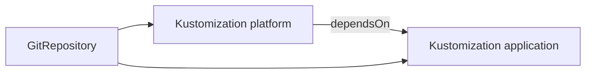

# Kustomization And HelmRelease Objects

A source makes content available. Two objects decide what is delivered from it: the Kustomization for plain manifests and Kustomize overlays, and the HelmRelease for Helm charts. This part explains the fields that matter, how Flux decides what to remove and what to wait for, and how a chart from Git becomes a release.

## The Kustomization

A Kustomization names a source in `spec.sourceRef`, a path inside the artifact in `spec.path`, and an interval of at least one minute. At each interval, and at once when the source has a new revision, the kustomize controller builds the path and applies the result with server-side apply. It then compares the applied objects with the live ones, and corrects differences.

The field `spec.prune` is required. With `prune: true`, objects that Flux applied earlier and that the new revision no longer contains are deleted. The controller knows them from its inventory, a list in `status.inventory` of every object it applied. An object can opt out with the annotation `kustomize.toolkit.fluxcd.io/prune: disabled`.

The field `spec.targetNamespace` sets the namespace on all objects. It does not create the namespace, which must exist or be part of the manifests. The field `spec.wait: true` makes the controller wait until all applied objects are ready, within `spec.timeout`, and the Kustomization becomes `Ready` only after that. Without `wait`, `Ready` means that the objects were applied.

The field `spec.dependsOn` lists other Kustomizations that must be `Ready` first. It orders deliveries, for example a platform Kustomization that creates namespaces before an application Kustomization. A circular dependency blocks both.



The diagram shows two Kustomizations on one source. The application one waits for the platform one.

## The HelmRelease

A HelmRelease describes a Helm release. The chart comes from `spec.chart.spec`, with a `chart` and a `sourceRef`. The source can be a `HelmRepository`, or a `GitRepository` when the chart is a directory in Git, as in `chart: ./chart`. Flux then creates a `HelmChart` object that packs the chart and reports its version.

The values come from `spec.values`, and optionally from ConfigMaps or Secrets in `spec.valuesFrom`. The inline values are merged over the others. The fields `spec.releaseName` and `spec.targetNamespace` decide the release name and the namespace of the objects. If the release name is not set, Flux builds one from the namespace and the object name.

The controller runs Helm install the first time and Helm upgrade after that. It stores a Helm release record in a Secret, in the namespace set by `spec.storageNamespace`, which is the namespace of the HelmRelease when not set. That record is the difference from Argo CD, which renders the chart and keeps no Helm release. Commands such as `helm list` and `helm history` can read it.

## A chart from Git and the reconcile strategy

A chart in Git is rebuilt into a new chart version when the strategy says so. The field `spec.chart.spec.reconcileStrategy` has two values. `ChartVersion`, the default, builds a new chart only when the `version` in `Chart.yaml` changes. `Revision` builds a new chart for every new Git revision, with the revision in the chart version.

With the default, a change to `values.yaml` or a template in Git does nothing until someone raises the chart version. This surprises many teams. If the chart should follow every commit, set `Revision`.

## Health checks and remediation

Both objects can check health. The Kustomization waits with `wait: true` or lists objects in `spec.healthChecks`. The HelmRelease runs Helm with a wait for the release objects, controlled by `spec.install` and `spec.upgrade`. These two fields also hold a `remediation` block. With `upgrade.remediation.retries` set, the Helm controller retries a failed upgrade, and with `remediation.strategy: rollback` it rolls back to the last good release when the retries are used up.

A rollback by Helm is a change in the cluster that Git does not show. The next reconcile of a commit that failed once will try the upgrade again. Keep a failed commit from repeating by fixing it in Git, and not by relying on the rollback.

## Try it: deliver an overlay with a Kustomization

This step needs a `GitRepository` named `scout` in `flux-system` that follows `main` of the repository with the Secret `scout-readonly`. Create it first if it does not exist, then add a Kustomization.

<!-- astrona:playground:renew -->

Save this as `kustomization-scout.yaml`:

```yaml
apiVersion: kustomize.toolkit.fluxcd.io/v1
kind: Kustomization
metadata:
  name: scout
  namespace: flux-system
spec:
  interval: 1m
  path: ./overlays/staging
  prune: true
  wait: true
  timeout: 3m
  sourceRef:
    kind: GitRepository
    name: scout
```

Apply it and read the result:

```sh
kubectl apply -f kustomization-scout.yaml
kubectl -n flux-system wait kustomization/scout --for=condition=Ready --timeout=240s
kubectl -n flux-system get kustomization scout -o jsonpath='{.status.lastAppliedRevision}{"\n"}'
kubectl -n flux-system get kustomization scout -o jsonpath='{.status.inventory.entries[*].id}{"\n"}'
```

The applied revision equals the revision of the source. The inventory lists the objects that Flux applied, as identifiers of namespace, name, group and kind. The overlay already sets the namespace `starfleet-staging`, and the playground created that namespace.

## Reading why a delivery waits

A Kustomization that is not `Ready` has a reason in the message of its `Ready` condition. The usual reasons are a build error in the path, a dependency that is not `Ready`, an object that the API server refused, and a health check that did not pass in time. With `wait: true` a failed health check keeps the Kustomization `False`, although the objects exist. Read the message first, then the events of the object, then the failing workload.

## Common pitfalls

> [!WARNING]
> A chart from Git with the default reconcile strategy ignores changes that do not raise the chart version, and a Kustomization with `prune: true` deletes objects that leave the path. Set `reconcileStrategy: Revision` when the chart follows commits, and read the inventory before you change a path.
