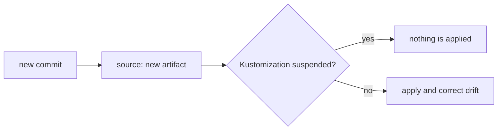

# Comparing Argo CD And Flux: Pause, Drift And Prune

Argo CD and Flux both keep a cluster equal to Git, but their defaults and their stored state differ. These differences decide what an operator must check during an incident. This part compares the two engines on the points that cause surprises, and shows how Flux pauses, corrects drift and prunes.

## Responsibilities that both engines share

Both engines fetch a source, render manifests, compare them with live state, apply the difference and report the result. Both can use Git, Helm and Kustomize. Both can order deliveries and wait for health. The model of the engine, not the goal, is what differs, and that is why the same task needs different objects and different checks.

| Question | Argo CD | Flux |
| --- | --- | --- |
| Unit of delivery | Application | Kustomization or HelmRelease |
| Fetching Git | repo-server, per Application | source-controller, shared by objects |
| Default after a Git change | Report only, unless a sync policy is set | Apply at the next interval |
| Correct drift in the cluster | Only with self-heal | Each interval, for Kustomizations |
| Remove deleted objects | Only with prune | Only with `prune: true` |
| Record of what it owns | Tracking annotation on each object | Inventory in the status |
| Helm charts | Rendered to manifests, no Helm release | Real Helm release record |
| Interface | Web page and command-line tool | Objects and the command-line tool |

The table does not rank the engines. It shows what to look at: for Argo CD read the sync policy and the Application status, for Flux read the interval, the suspend field and the conditions.

## Drift correction in Flux

At each interval the kustomize controller applies the desired state again with server-side apply. A field that someone changed by hand, such as the replica count, is set back to the value in Git. No extra setting is needed. The controller does not watch the cluster for changes. It finds the drift at the next run, so the time to correction is up to one interval.

An object can opt out with the annotation `kustomize.toolkit.fluxcd.io/reconcile: disabled`, and fields can be left to other controllers with `spec.ignore` or by managing them with another field manager. A HelmRelease works differently. The Helm controller corrects drift from the Helm release only when `spec.driftDetection.mode` is `enabled`. With `warn` it only reports drift as an event, and with the field unset it does not compare the live objects with the release.

## Suspend and resume

Each Flux object has `spec.suspend`. When it is `true`, the controller skips the object. A suspended Kustomization does not apply new revisions and does not correct drift. A suspended HelmRelease does not install or upgrade. A suspended source does not fetch.

Suspend is a pause that survives restarts, because it is part of the stored object. It is also silent: the object keeps its old `Ready` status, so the condition can say `True` while the cluster is behind Git. The command-line tool writes the same field with `flux suspend` and `flux resume`, and `kubectl patch` works as well.



The diagram shows that a new commit reaches the cluster only when the Kustomization is not suspended.

## Prune in Flux

With `prune: true` the controller deletes the objects that are in its inventory and not in the new build. The inventory is stored in the status, so a person who deletes the Kustomization with `deletionPolicy` at its default also removes the objects when pruning is on. With `prune: false` removed objects stay, and the same holds for objects that are deleted from Git.

## Try it: see drift correction and suspend

This step needs the `GitRepository` named `scout` and a Kustomization named `scout` for `./overlays/staging` with `interval: 1m`, `prune: true` and `wait: true`. Create them if they do not exist.

<!-- astrona:playground:renew -->

Scale the Deployment by hand and wait for the next interval:

```sh
kubectl -n starfleet-staging scale deploy/scout --replicas=3
kubectl -n starfleet-staging get deploy scout -o jsonpath='{.spec.replicas}{"\n"}'
```

Run the second command again after about a minute. Flux applied the overlay again and the replicas are back at 1. Nothing in the Kustomization asked for it. Now suspend the Kustomization and scale again:

```sh
kubectl -n flux-system patch kustomization scout --type merge -p '{"spec":{"suspend":true}}'
kubectl -n starfleet-staging scale deploy/scout --replicas=3
```

Wait two minutes and read the replicas. They stay at 3. Read the condition and the suspend field:

```sh
kubectl -n flux-system get kustomization scout -o jsonpath='{.spec.suspend}{" "}{.status.conditions[?(@.type=="Ready")].status}{"\n"}'
```

The output shows `true` and the old `Ready` status. Resume it and the replicas return to 1:

```sh
kubectl -n flux-system patch kustomization scout --type merge -p '{"spec":{"suspend":false}}'
```

## Choosing and mixing

Teams choose by how they work. A team that wants a visual map of Applications and a manual approval step often uses Argo CD. A team that wants small composable controllers and automatic apply often uses Flux. Some teams run both, for example Flux for the platform and Argo CD for applications. Two engines must never manage the same object, because each will correct what the other does.

## Common pitfalls

> [!WARNING]
> A suspended Flux object keeps a `Ready` status that no longer describes the cluster, so a green condition can hide an environment that is behind Git. Check `spec.suspend` first when an environment does not follow a commit, and never let two engines manage the same object.
