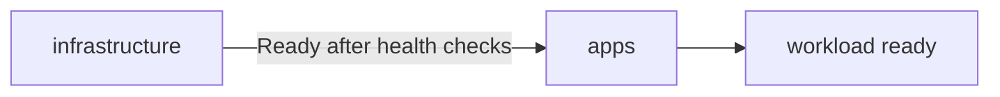

# Flux Dependencies, Health Checks And Substitution

A single Kustomization that applies one folder is the simple case. A cluster needs an order: the custom resource definitions before the objects that use them, the database before the application. Flux provides dependencies, health checks and variable substitution for this. This part explains each, and how they fail.

## Ordering with dependsOn

A Kustomization can list other Kustomizations in `spec.dependsOn`. Flux reconciles the dependent object only when every listed object is Ready. Until then the object shows a condition that names the missing dependency.

```yaml
apiVersion: kustomize.toolkit.fluxcd.io/v1
kind: Kustomization
metadata:
  name: apps
  namespace: flux-system
spec:
  interval: 5m
  path: ./apps
  prune: true
  sourceRef:
    kind: GitRepository
    name: scout
  dependsOn:
    - name: infrastructure
```

Dependencies form a graph. A cycle is an error. The dependency is checked on each reconciliation, so if `infrastructure` later becomes not Ready, `apps` stops updating until it recovers. The names refer to objects in the same namespace unless a `namespace` is given.

## Health checks and wait

Ready on a Kustomization means that the apply worked. It does not mean that the workload is running. Two fields add that check.

- `spec.wait: true` makes Flux wait until all objects it applied are ready, using the status of each kind. A Deployment is ready when its rollout is complete, a Job when it succeeds.
- `spec.healthChecks` lists specific objects to wait for, by `apiVersion`, `kind`, `name` and `namespace`. Use it to wait for only a few objects, or for custom resources that `wait` handles in a general way.

`spec.timeout` limits how long Flux waits. If the timeout passes, the Kustomization reports `Ready=False` with the reason and retries on the next interval. Because a dependent Kustomization waits for Ready, health checks decide whether the next layer starts at all.



The diagram shows the second layer starting only after the first one reports Ready with its checks passed.

## Variable substitution

A Kustomization can fill variables in the manifests before applying them. The field `spec.postBuild.substitute` holds literal values, and `spec.postBuild.substituteFrom` reads them from a ConfigMap or Secret.

```yaml
spec:
  postBuild:
    substitute:
      cluster_name: outpost
    substituteFrom:
      - kind: ConfigMap
        name: cluster-vars
```

In the manifests, `${cluster_name}` is replaced by the value. A default can be written as `${cluster_name:=local}`. Substitution runs after Kustomize builds the output, so it applies to the final text. A literal dollar sign must be written as `$${`. Flux fails the apply if a variable has no value and no default. This is the Flux way to keep one set of manifests and vary them per cluster, where Argo CD would use an ApplicationSet or Helm values.

## Patches and images in the Kustomization

The object also accepts `spec.patches`, a list of strategic merge or JSON patches with a target selector, and `spec.images`, which overrides image names and tags. These apply to the build output without changing files in Git, which is handy for a cluster-specific change. Because the change lives in the Flux object, a reader of the Git folder alone does not see it.

## Decryption

Secrets in Git must be encrypted. `spec.decryption` with `provider: sops` and a `secretRef` makes the kustomize controller decrypt files that were encrypted with SOPS before it applies them. The key is a Secret in the cluster. Only the controller can read the plain value.

## Try it: add an order

Run these commands in the playground:

<!-- astrona:playground:renew -->

```sh
kubectl -n flux-system get kustomization
kubectl -n flux-system get kustomization -o jsonpath='{range .items[*]}{.metadata.name}{" depends on "}{.spec.dependsOn}{" wait="}{.spec.wait}{"\n"}{end}'
```

The output shows each Kustomization with its dependencies and whether it waits. Create a second Kustomization that reads the production overlay and lists `scout-staging` in `dependsOn`. It stays idle until the staging object is Ready. Suspend the first one with `kubectl -n flux-system patch kustomization scout-staging --type merge -p '{"spec":{"suspend":true}}'`, change the second, and read its condition. Resume the first one afterwards.

## Common mistakes

- Assuming Ready means the workload is running without `wait` or `healthChecks`.
- Forgetting `$${` for a literal dollar sign in a script.
- Creating a dependency cycle.
- Putting a patch in the Kustomization and not telling the readers of the folder.

## Check yourself

- What does `dependsOn` wait for?
- What does `wait: true` add to Ready?
- Where does substitution run in the build?
