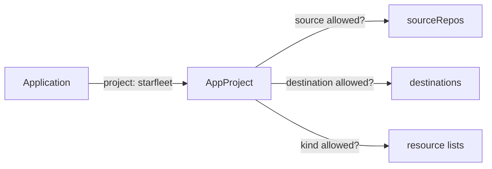

# AppProject Guardrails

Every Argo CD Application belongs to exactly one project. Until now the Applications in this course used the project `default`, which allows everything. That is fine for one learner on one cluster. It is not fine when several teams share Argo CD, because any team could then deploy any repository to any namespace, including the namespaces of other teams. The `AppProject` is the object that draws those limits. This part explains what a project restricts and how the checks work.

## What a project holds

An `AppProject` is a custom resource in the namespace where Argo CD runs, normally `argocd`. Its `spec` has these groups of fields:

- `sourceRepos` lists the Git or OCI repositories that Applications in the project may read. A value is a URL or a pattern with `*`.
- `destinations` lists the pairs of cluster and namespace that Applications may deploy to. A cluster is named by `server` or by `name`. A namespace may be a pattern.
- `clusterResourceWhitelist` and `clusterResourceBlacklist` control cluster-scoped kinds such as `Namespace`, `ClusterRole` and `CustomResourceDefinition`.
- `namespaceResourceWhitelist` and `namespaceResourceBlacklist` control namespaced kinds such as `Deployment` and `Secret`.
- `roles` define project-level permissions and tokens.
- `syncWindows` limit when syncs may run.

If a list is empty, the meaning depends on the field. An empty `sourceRepos` or `destinations` allows nothing. An empty `clusterResourceWhitelist` allows no cluster-scoped kind. An empty `namespaceResourceWhitelist` allows every namespaced kind unless a blacklist removes some. The default project is permissive because it sets `*` in the source, destination and cluster-resource fields.

## Where the checks happen

Argo CD checks the project at two points.

1. When an Application is created or changed, the API server of Argo CD checks that the source and destination are allowed. A violation is reported as a condition on the Application, such as `InvalidSpecError`, and the Application cannot sync.
2. During a sync, Argo CD checks every rendered object against the kind lists. An object of a forbidden kind is not applied. The sync fails with a message that names the kind and the project.



The diagram shows one Application being tested against three lists in its project.

The project does not stop a person with Kubernetes access from creating objects by hand. It only controls what Argo CD itself will apply. Protecting the cluster from people needs Kubernetes access control as well.

## A namespace needs a cluster-scoped permission

A `Namespace` is not inside any namespace, so it counts as a cluster-scoped kind. An Application that uses the sync option `CreateNamespace=true` makes Argo CD create the namespace. If the project has no entry for the kind `Namespace` in `clusterResourceWhitelist`, the sync fails. The message says that the resource of group `""` and kind `Namespace` is not permitted in the project.

The usual design is to allow only `Namespace` as a cluster-scoped kind for ordinary teams, and to keep `ClusterRole`, `ClusterRoleBinding` and `CustomResourceDefinition` for a platform project that only the platform team can use. Another design is to create the namespaces in a separate, trusted Application and to leave the cluster-scoped list empty for the team project.

## Roles and tokens

A project can carry roles. A role has policies in the same format as the Argo CD RBAC file, limited to the project, such as `p, proj:starfleet:deployer, applications, sync, starfleet/*, allow`. A role can be bound to groups from the single sign-on provider, or it can have a JWT token for automation. This lets a team sync its own Applications without being an Argo CD administrator.

Sync windows add a time rule. A window has a `kind` of `allow` or `deny`, a cron `schedule`, a `duration` and a list of `applications`, `namespaces` or `clusters` that it covers. A deny window blocks automated syncs during the window. A manual sync can be allowed through with the `manualSync` field.

## Orphaned resources and signature checks

Two more project settings help with control. `orphanedResources` makes Argo CD report objects in the destination namespaces that no Application owns, so that hand-made objects show up in the UI. With `warn: true` it only reports. `signatureKeys` lists GPG key IDs, and Argo CD then syncs only commits signed by one of them.

## Try it: restrict a project

Save this as `appproject-starfleet.yaml`:

<!-- astrona:playground:renew -->

```yaml
apiVersion: argoproj.io/v1alpha1
kind: AppProject
metadata:
  name: starfleet
  namespace: argocd
spec:
  description: Applications of the drifter team
  sourceRepos:
    - http://gitea-http.gitea.svc:3000/starfleet/scout-deploy.git
  destinations:
    - server: https://kubernetes.default.svc
      namespace: starfleet-staging
  clusterResourceWhitelist:
    - group: ""
      kind: Namespace
```

Apply it:

```sh
kubectl apply -f appproject-starfleet.yaml
```

Then check the result:

```sh
kubectl -n argocd get appproject starfleet -o yaml
```

The output repeats the lists you set. Now create an Application in this project that deploys the overlay `overlays/production` to the namespace `starfleet-production`. The destination is not listed, so the Application shows a condition that names the destination and the project, and it does not sync. Change the namespace to `starfleet-staging` and the condition disappears.

## Common mistakes

- Leaving every Application in `default`. Nothing then limits the repositories or the namespaces.
- Forgetting that `CreateNamespace=true` needs the kind `Namespace` in the cluster-resource list.
- Listing the repository URL in a different form from the one in the Application, such as with and without `.git`. The match is on the string.
- Assuming the project protects the cluster from people. It controls only what Argo CD applies.

## Check yourself

- Which three lists does Argo CD test when an Application is created?
- Why does an empty `destinations` list stop every Application?
- Which setting lets Argo CD create a namespace, and which project field must allow it?
