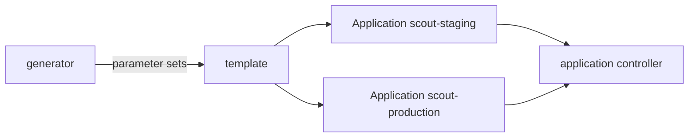

# ApplicationSet Generators And Templates

Writing one Application per service and per environment by hand does not scale, and the copies drift apart. The `ApplicationSet` is a second controller in Argo CD that writes Applications for you. You give it a generator, which produces a list of parameter sets, and a template, which is an Application with placeholders. The controller renders the template once per parameter set and keeps the results in step with the generator. This part explains how that works.

## The controller loop

The ApplicationSet controller runs next to the other Argo CD components. For each `ApplicationSet` object it does the following:

1. Run the generators and collect parameter sets.
2. Render the template once for each set.
3. Compare the rendered Applications with the Applications it already owns.
4. Create the missing ones, update the changed ones, and delete the ones whose parameter set is gone.

Every generated Application has an `ownerReference` that points at the ApplicationSet. That reference is how the controller finds its own Applications, and it is also why deleting the ApplicationSet deletes them. The Applications then behave like any other: the application controller syncs them, and the project rules apply to them.



The diagram shows one template producing two Applications, which the normal controller then syncs.

## The list generator

The list generator is the simplest one. Its `elements` are written in the ApplicationSet itself. Each element is a map of keys and values, and each key becomes a placeholder.

```yaml
generators:
  - list:
      elements:
        - env: staging
          namespace: starfleet-staging
        - env: production
          namespace: starfleet-production
```

In the template, `{{env}}` is replaced by `staging` or `production`. The default template engine is fasttemplate, which replaces `{{key}}` with the value and does nothing more. Setting `goTemplate: true` on the ApplicationSet switches to Go templates. Placeholders then look like `{{ .env }}`, and functions such as `default` and `printf` become available. Pick one engine per ApplicationSet and do not mix them.

## The Git directory generator

The Git directory generator reads a repository and makes one parameter set for each directory that matches a path pattern.

```yaml
generators:
  - git:
      repoURL: http://gitea-http.gitea.svc:3000/starfleet/scout-deploy.git
      revision: main
      directories:
        - path: overlays/*
```

Each match provides `path` and `path.basename`, so `overlays/staging` gives the basename `staging`. A new directory in Git makes a new Application with no change to the ApplicationSet. An entry with `exclude: true` removes matches. The Git file generator is related: it reads JSON or YAML files and uses their keys as parameters, which allows per-environment values to live in the repository.

## The cluster generator

The cluster generator makes one parameter set for each cluster registered in Argo CD. Each cluster is a Secret with the label `argocd.argoproj.io/secret-type: cluster`. A `selector` with `matchLabels` limits which clusters count. The parameters include `name`, `server` and the labels of the Secret. This is the generator for rolling out the same Application to every cluster in a fleet.

## Combining generators

The matrix generator takes two generators and produces every combination of their outputs, for example every cluster with every directory. The merge generator joins the output of several generators on a key and lets later generators override earlier ones. Both are useful for large fleets and are best avoided until a plain generator is not enough.

## The template

The template has two parts. `template.metadata` holds the name and labels of the Application. `template.spec` is the full Application spec. The name must be unique across the generated set, so it must contain at least one placeholder. A template that renders to the same name twice is an error.

```yaml
template:
  metadata:
    name: 'scout-{{env}}'
  spec:
    project: starfleet
    source:
      repoURL: http://gitea-http.gitea.svc:3000/starfleet/scout-deploy.git
      targetRevision: main
      path: 'overlays/{{env}}'
    destination:
      server: https://kubernetes.default.svc
      namespace: '{{namespace}}'
    syncPolicy:
      automated: {}
      syncOptions:
        - CreateNamespace=true
```

Quote any value that starts with a placeholder, because `{{` begins a flow mapping in YAML. The `project` field in the template matters: it decides which project rules apply to every generated Application.

## What happens on change and on delete

Editing the template or an element updates the generated Applications. Removing an element deletes its Application, and because the Application has the finalizer for resources, Argo CD also removes what it deployed. This is the intended clean-up, and it can also be an accident. The field `spec.syncPolicy.preserveResourcesOnDeletion: true` on the ApplicationSet keeps the deployed objects when the Application is deleted. The field `applicationsSync` limits what the controller may do to Applications: `create-only`, `create-update`, `create-delete` or `sync`.

## Try it: generate two environments

Save this as `applicationset-scout-envs.yaml`:

<!-- astrona:playground:renew -->

```yaml
apiVersion: argoproj.io/v1alpha1
kind: ApplicationSet
metadata:
  name: scout-envs
  namespace: argocd
spec:
  generators:
    - list:
        elements:
          - env: staging
            namespace: starfleet-staging
          - env: production
            namespace: starfleet-production
  template:
    metadata:
      name: 'scout-{{env}}'
    spec:
      project: starfleet
      source:
        repoURL: http://gitea-http.gitea.svc:3000/starfleet/scout-deploy.git
        targetRevision: main
        path: 'overlays/{{env}}'
      destination:
        server: https://kubernetes.default.svc
        namespace: '{{namespace}}'
      syncPolicy:
        automated: {}
        syncOptions:
          - CreateNamespace=true
```

Apply it:

```sh
kubectl apply -f applicationset-scout-envs.yaml
```

Then check the result:

```sh
kubectl -n argocd get applicationset scout-envs
kubectl -n argocd get applications
```

Two Applications appear. Read the `ownerReferences` of one with `kubectl -n argocd get application scout-staging -o yaml`. Then remove the production element, apply again, and watch the Application `scout-production` disappear. Put the element back to restore it.

## Common mistakes

- Using a template name with no placeholder, so every set renders the same name.
- Mixing `{{env}}` and `{{ .env }}` in one ApplicationSet.
- Forgetting that removing an element deletes the deployed workload.
- Setting a project that does not allow the generated destinations, so the Applications appear but do not sync.

## Check yourself

- How does the controller know which Applications it owns?
- What does the Git directory generator add compared with the list generator?
- Which field keeps the workload when an Application is deleted?
