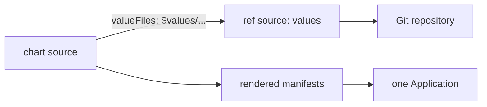

# Multiple Sources And Values From Git

A single Application normally has one `source`. That is a problem for a common layout: the Helm chart comes from a chart repository or a registry, and the values for each environment live in a Git repository that the team controls. Without a way to combine them, the team must copy the chart into Git or put the values inside the Application object. Argo CD solves this with `sources`, a list that lets one Application read from several places and combine the results. This part explains how that works and where it is limited.

## The sources list

Instead of the field `source`, an Application can use `sources`, a list of source entries. Each entry has its own `repoURL`, `targetRevision` and either `path` for a Git directory or `chart` for a Helm chart. Argo CD fetches every entry, renders each one, and applies the combined result as one Application with one sync status.

```yaml
spec:
  sources:
    - repoURL: http://gitea-http.gitea.svc:3000/starfleet/scout-deploy.git
      targetRevision: main
      path: overlays/staging
    - repoURL: http://gitea-http.gitea.svc:3000/starfleet/scout-deploy.git
      targetRevision: main
      path: extras
```

The two entries are rendered separately and their objects are merged. If both produce an object with the same group, kind, namespace and name, the sync reports a conflict, so the sources must produce different objects.

## A ref source for values

The more important use is the `ref` field. A source with `ref: values` is not rendered at all. It only makes the files of that repository available to the other sources under the name `$values`.

```yaml
spec:
  project: starfleet
  sources:
    - repoURL: oci://registry.registry.svc:5000/charts
      chart: scout
      targetRevision: 1.2.0
      helm:
        valueFiles:
          - $values/environments/staging/values.yaml
    - repoURL: http://gitea-http.gitea.svc:3000/starfleet/scout-deploy.git
      targetRevision: main
      ref: values
  destination:
    server: https://kubernetes.default.svc
    namespace: starfleet-staging
```

The chart is the first source. Its `valueFiles` entry begins with `$values/`, and Argo CD replaces that prefix with the checkout of the source whose `ref` is `values`. The path after the prefix is relative to the root of that repository. The name after `ref` is free, so a repository with several roles can use `ref: config` and `$config/...`.



The diagram shows the chart source reading its value file from the Git checkout named by the ref source.

## What a change triggers

Argo CD tracks each source. A commit in the values repository changes the revision of the ref source, so the Application refreshes and shows a diff. A new chart version changes the revision of the chart source. Both appear in the Application status, which now lists `sources` and a revision for each in `status.sync.revisions`. The command-line tool and the UI show the list.

## Limits to know

- The `ref` source is for files only. Argo CD does not render it, so objects in it are not applied.
- The order matters only for the `$values` lookup: the ref source can appear before or after the chart.
- A webhook for the values repository refreshes the Application, but only if the repository URL matches the source URL.
- Rollback by history works per sync, and it restores the whole list of revisions, not one source.
- A `ref` source cannot point to a path. It always represents the whole repository at one revision.
- A value file that is missing makes the render fail. A path typed with the wrong case is a common cause.

## When not to use it

Multiple sources add moving parts. If the chart lives in the same repository as the values, a single Git source with a Helm path is simpler. If a team wants the chart to change only through a reviewed commit, a single source that pins a chart version in Git is easier to audit. Use `sources` when the chart and the values truly have different owners or release schedules.

An alternative that keeps one source is Kustomize with a `helmCharts` entry, which renders a chart inside the build and takes the values from the same repository. It needs the `--enable-helm` build option set in `argocd-cm`, so it is a platform decision.

## Multiple sources in an ApplicationSet

The template of an ApplicationSet can carry `sources` as well. Placeholders then pick the values file by environment, for example `$values/environments/{{env}}/values.yaml`. One chart source and one ref source, with the environment in the path, replace a set of near-identical Application files.

## Try it: read a two-source Application

Save this as `application-scout-two-sources.yaml`:

<!-- astrona:playground:renew -->

```yaml
apiVersion: argoproj.io/v1alpha1
kind: Application
metadata:
  name: scout-two-sources
  namespace: argocd
spec:
  project: default
  sources:
    - repoURL: http://gitea-http.gitea.svc:3000/starfleet/scout-deploy.git
      targetRevision: main
      path: overlays/staging
    - repoURL: http://gitea-http.gitea.svc:3000/starfleet/scout-deploy.git
      targetRevision: main
      ref: values
  destination:
    server: https://kubernetes.default.svc
    namespace: starfleet-staging
  syncPolicy:
    automated: {}
    syncOptions:
      - CreateNamespace=true
```

Apply it:

```sh
kubectl apply -f application-scout-two-sources.yaml
```

Then check the result:

```sh
kubectl -n argocd get application scout-two-sources -o jsonpath='{.status.sync.revisions}'
```

The output lists one revision for each source. The second source is a ref and renders nothing, so the workload comes from the first source alone. Change the first source to a path that does not exist and watch the Application report a comparison error. Restore it afterwards.

## Common mistakes

- Using both `source` and `sources` in one Application. Only one of the two is allowed.
- Writing `$values` without the matching `ref: values` entry.
- Expecting a ref source to deploy its files.
- Changing the repository URL in one source and not in the ref source, so the webhook refresh no longer matches.

## Check yourself

- What does Argo CD do with a source that has only `ref`?
- How is a value file in Git named inside a chart source?
- When is a single Git source a better choice than `sources`?
