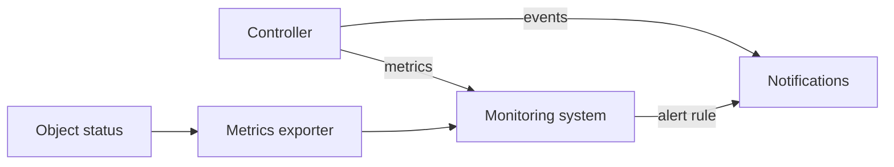

# Observing Delivery: Status, Events And Metrics

A delivery can be observed in three places: the status of the objects, the events they record, and the metrics the controllers export. They answer different questions and they have different weaknesses. This part explains what each one contains, how Flux and Argo CD expose them, and why a single "success" signal is often ambiguous.

## Status: the current state

The status of a Flux object is a summary of the last reconcile. The `conditions` list holds a `Ready` condition with a status of `True`, `False` or `Unknown`, a reason and a message. The Kustomization also records `lastAppliedRevision`, the revision that was applied successfully, and `lastAttemptedRevision`, the revision that was tried last. When both are equal and `Ready` is `True`, the attempt worked. When they differ and `Ready` is `False`, the newest commit failed and the cluster still holds the older one. The inventory in `status.inventory` lists what was applied. A source records `status.artifact.revision`.

An Argo CD Application has two fields: `status.sync.status`, which compares Git and the cluster, and `status.health.status`, which judges the objects. It also records `status.sync.revision`, the commit that was compared, and `status.operationState`, which holds the phase, the message and the time of the last sync. `status.history` keeps earlier revisions that were synced.

Status is the right place to read the present. It does not contain the past: it holds the last result and overwrites it with the next one.

## Events: what happened

Events are Kubernetes objects with a reason, a message and a count, attached to the object they are about. They show the steps of a reconcile, such as an applied change, a failed health check or a retry. Kubernetes keeps events for a short time, one hour by default, so they are not a long record. The command `kubectl events --for` and the `describe` output of an object list them.

Events are the place to read why. A `False` condition says that a delivery failed. The event shows what the controller tried and what the API server said.

## Metrics: what happens over time

The controllers export metrics in the Prometheus text format, which a monitoring system scrapes and stores. Metrics give trends and let an alert rule fire without a person reading status.

Flux controllers serve metrics on port 8080 at `/metrics`. The metric `gotk_reconcile_duration_seconds` is a histogram with the labels `kind`, `name` and `namespace`, so it shows how often and how long each object reconciles. The state of the objects, such as ready, suspended and revision, is not exported by the controllers. It comes from kube-state-metrics with a custom resource configuration, as the metric `gotk_resource_info` with labels such as `ready`, `suspended` and `revision`. That metric answers "which objects are suspended or not ready" in one query.

Argo CD exports metrics from the application controller on port 8082 of the `argocd-metrics` Service. The gauge `argocd_app_info` carries the labels `sync_status` and `health_status` for each Application, and `argocd_app_sync_total` counts syncs by phase. Together they support an alert for an Application that has been `OutOfSync` or `Degraded` for longer than a set time.



The diagram shows two routes to a person. Events go through the notification controller. Metrics go to a monitoring system, which sends an alert by its own rules.

## Ambiguous success signals

Several signals look like success and mean less than they appear to.

- `Ready: True` on a Kustomization without `wait` means the objects were applied. It does not mean that the workload runs. With `wait: true` it also means the objects were healthy within the timeout.
- `Synced` in Argo CD means the cluster matches Git. A Deployment that matches Git and crash loops is `Synced` and `Degraded`.
- A successful sync event means a reconcile finished. It does not mean the application answers requests. Only a probe or a request from a client shows that.
- A rollout can appear stuck while the old pods still serve traffic. The environment works but runs the old version, and the status of the newest revision is a failure.
- A missing alert is not a healthy system. A broken notification path and a quiet system look the same.

The reliable practice is to combine signals: the revision that was applied, the health of the workload, and a request that exercises the behaviour. Each one covers a gap in the others.

## Delay and ordering

Each signal has its own delay. A source fetches at its interval or on a webhook. A controller reconciles after the source changes, then waits for readiness. Metrics are scraped at an interval, often every fifteen to sixty seconds, and alert rules usually need a condition to hold for a minute or more before they fire. A notification built on metrics arrives later than one built on events. Do not compare timestamps across signals as if they were exact.

## Try it: read the three signals

This exercise reads the status, the events and the metrics of the Kustomization that the playground created.

<!-- astrona:playground:renew -->

Read the status fields:

```sh
kubectl -n flux-system get kustomization scout-staging -o jsonpath='{.status.lastAppliedRevision}{"\n"}{.status.lastAttemptedRevision}{"\n"}'
kubectl -n flux-system get kustomization scout-staging -o jsonpath='{.status.conditions[?(@.type=="Ready")].status}{" "}{.status.conditions[?(@.type=="Ready")].reason}{"\n"}'
```

Read the events of the object:

```sh
kubectl -n flux-system events --for kustomizations.kustomize.toolkit.fluxcd.io/scout-staging
```

Open a port forward to the controller metrics in a second terminal and read the reconcile histogram for the Kustomization:

```sh
kubectl -n flux-system port-forward deploy/kustomize-controller 18080:8080
```

```sh
curl -s http://127.0.0.1:18080/metrics | grep gotk_reconcile_duration_seconds_count | grep scout-staging
```

The count rises each time the object reconciles. Request a reconcile with `kubectl -n flux-system annotate kustomization/scout-staging --overwrite reconcile.fluxcd.io/requestedAt="$(date +%s)"`, read the count again, and compare. The playground has no monitoring system, so the resource metrics from kube-state-metrics are not available here, but the controller metrics are.

## Reading a stuck delivery in order

For a delivery that does not behave as expected, read the signals in this order. First the status: is the object `Ready`, and are the applied and attempted revisions equal? Second the events: what did the last attempt do? Third the workload: do the pods run the expected image, and do they pass their probes? Fourth a request: does the service answer as expected? The metrics tell whether the problem is new or has lasted, which decides how urgent it is.

## Common pitfalls

> [!WARNING]
> Do not treat a quiet alert channel or a `Ready: True` condition as proof that a release works. Check the revision that was applied, the state of the workload, and a real request. A silent notification path looks the same as a healthy system.

Events expire after about an hour, so a failure from last night may leave no event. Read the status for the present and keep notifications or metrics for history.

A metric for the state of Flux objects needs kube-state-metrics with the Flux custom resource configuration. Without it, a dashboard that expects `gotk_resource_info` stays empty, and the controllers' own metrics do not fill the gap.

Key facts:

- Status shows the present, events show what happened recently, metrics show trends.
- A Kustomization with different applied and attempted revisions has a failed newest commit.
- Flux controllers serve metrics on port 8080, and Argo CD serves them on port 8082.
- Object state in Flux comes from kube-state-metrics, and in Argo CD from `argocd_app_info`.
- A success signal is ambiguous until the revision, the health and a real request agree.

