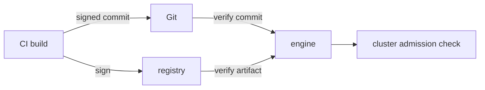

# Provenance: Signing And Verifying What Runs

The earlier parts followed a change from CI to the cluster and described the signals that report on it. They did not ask whether the thing that arrived is the thing that was built. Provenance is the record of where a change came from, and verification is the check that the record is genuine before the engine acts on it. This part covers the two places where a GitOps pipeline can verify: the commit and the artifact.

## What can be forged

There are three points in the path where the wrong content can enter.

- A commit in the deployment repository, written by someone who should not have write access, or by a stolen credential.
- An image or artifact in the registry, replaced under the same tag.
- A build that was not made by the trusted pipeline, such as an image built on a laptop and pushed by hand.

Signatures answer each of these. A signature binds content to a key, so a reader can check who produced it and that it has not changed.

## Verifying commits

Git can sign a commit with a GPG key or an SSH key. The signature is stored in the commit. A reader with the public key can check it.

Argo CD checks GPG signatures. The administrator adds the public keys to Argo CD, and a project lists the allowed key IDs in `signatureKeys`. When a project has signature keys, Argo CD syncs only a commit that is signed by one of them. An unsigned commit, or one signed with an unknown key, produces a comparison error and no sync.

Flux checks signatures on the `GitRepository`. The field `spec.verify` sets a `mode`, such as `HEAD` to check the commit at the tip, and a `secretRef` that holds the public keys. If the check fails, the GitRepository is not Ready and no artifact is produced, so nothing downstream applies. Because the artifact is not produced, the cluster stays on the last good revision.

## Verifying artifacts

An image or an OCI artifact can be signed with Cosign. A signature is stored in the registry next to the artifact, and it can be keyless, tied to the identity of the CI job through an identity provider, or tied to a key pair. The verification checks the signature against the digest of the artifact.

Flux checks the signature of an OCI artifact. The `OCIRepository` has `spec.verify` with `provider: cosign` and either a `secretRef` with a public key or a `matchOIDCIdentity` list for keyless signatures. A failed check leaves the source not Ready. Images that run in the cluster are usually checked by an admission policy, which rejects a pod whose image has no valid signature. That check happens at the API server, and applies to anything that creates pods, including the engine.



The diagram shows verification at the commit, at the artifact and at admission, each one independent of the others.

## Attestations and provenance records

A signature says who. An attestation says what and how. A provenance attestation records the source repository, the commit, the builder and the build inputs. It is stored in the registry as a signed document linked to the image. A policy can then require that an image was built from the main branch by the trusted pipeline, not just that someone with a key signed it. The cluster can enforce this, and the engine can show the result.

## What verification does not cover

- A signed commit that contains a bad change is still bad. Review catches this, signatures do not.
- A signature proves a key, not the safety of the key. A stolen key signs bad content.
- Verification at one point does not replace the others. A signed image is not proof that the manifests that run it are trusted.
- A tag can still move. Verification works on the digest, so reference the digest or enforce immutable tags.

## Ambiguous signals

A failed verification shows up in different places depending on the tool. In Argo CD it is a comparison error on the Application. In Flux it is the Ready condition of the source, with a message and an event. Add the source objects to the notification Alert from the earlier part, so a failed verification reaches people. An engine that silently stays on the old revision looks healthy in the cluster while the new release never arrives.

## Try it: read the verification fields

Run these commands in the playground:

<!-- astrona:playground:renew -->

```sh
kubectl -n flux-system get gitrepository scout -o jsonpath='{.spec.verify}'
kubectl -n flux-system get gitrepository scout -o jsonpath='{.status.conditions}'
```

The first command prints nothing, because the playground repository has no verification configured. The second shows the conditions, which are where a verification failure would appear. Read the fields `verify` in the reference of the `GitRepository` and compare them with the fields of the Argo CD project `signatureKeys`.

## Common mistakes

- Treating a signature as proof that a change is safe.
- Verifying the image but not the commit, or the reverse.
- Letting a failed verification pass without an alert.
- Trusting a tag instead of a digest.

## Check yourself

- Which Argo CD setting lists the keys allowed to sign commits?
- Which Flux field enables Cosign verification of an OCI artifact?
- Why does a signed commit not prove the change is correct?
