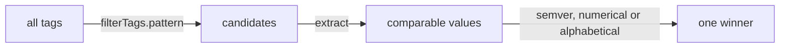

# Flux ImageRepository And ImagePolicy

Flux can watch a registry and choose a tag, using two objects served by the image reflector controller. This part explains what each object does, how a policy selects a tag, and how to read the result. Nothing in this part changes Git or the cluster workload. The objects only produce a result in their status.

## The image reflector controller

The image reflector controller is an optional Flux component. It scans registries and stores the list of tags in its own database inside the controller. In the Flux 2.9.6 install manifest the controller is present, and it must be running for the objects below to work. The controller needs no Git access.

## ImageRepository

An `ImageRepository` tells the controller which image to scan and how often.

```yaml
apiVersion: image.toolkit.fluxcd.io/v1
kind: ImageRepository
metadata:
  name: scout
  namespace: flux-system
spec:
  image: ghcr.io/stefanprodan/podinfo
  interval: 1m
```

The `image` field is the repository without a tag. The `interval` is the time between scans. Other fields cover private registries: `secretRef` names a Secret of type `kubernetes.io/dockerconfigjson`, `serviceAccountName` uses a service account with image pull secrets, and `provider` can be `aws`, `azure` or `gcp` to use cloud credentials. `insecure: true` allows plain HTTP, and `certSecretRef` supplies a custom certificate authority. `exclusionList` is a list of regular expressions for tags that must be ignored. The default list ignores tags that end in `.sig`.

The status holds `lastScanResult`. It has `tagCount`, the number of tags found, `scanTime`, and `latestTags`, a short list of the newest tags. The Ready condition is true when the last scan worked. A failing scan shows the registry error in the condition message, for example an authorization failure.

## ImagePolicy

An `ImagePolicy` picks one tag from the scanned list.

```yaml
apiVersion: image.toolkit.fluxcd.io/v1
kind: ImagePolicy
metadata:
  name: scout
  namespace: flux-system
spec:
  imageRepositoryRef:
    name: scout
  policy:
    semver:
      range: 6.15.x
```

The `policy` field holds exactly one of three rules.

- `semver` with a `range`. Tags that parse as semantic versions are compared, and the highest one inside the range wins. The range uses the same syntax as a Flux `OCIRepository`: `>=6.15.0 <7.0.0`, `6.x` or `~6.15`. Tags that do not parse are ignored.
- `numerical` with an `order` of `asc` or `desc`. The numbers found in the tags are compared. The tag with the highest number wins for `asc`.
- `alphabetical` with an `order`. The tags are sorted as strings. This fits date tags such as `20260112`.

Two optional fields shape the candidates before the rule runs. `filterTags.pattern` is a regular expression, and only tags that match it are considered. `filterTags.extract` is a replacement string such as `$ts` that picks a named group from the match, so the rule compares only that part. A tag such as `main-20260112T101500Z-abc1234` can be reduced to its timestamp with a pattern `^main-(?P<ts>[0-9T]+Z)-.*` and `extract: '$ts'`, and then compared with `numerical` or `alphabetical`.



The diagram shows the order of the steps: filter, extract, compare, choose.

## Reading the policy status

The status holds `latestRef`, with the `name` of the image, the `tag` and the `digest`, and `observedPreviousRef`, the tag chosen before. When the winner changes, the controller records the old one in `observedPreviousRef`. This pair is the first thing to read when someone asks why the cluster moved. A policy whose rule matches no tag reports a Ready condition of false with a message that no image was found.

## Digest reflection

Setting `spec.digestReflectionPolicy` makes the policy also record the digest of the chosen tag. The value `Always` refreshes the digest on every scan, and `IfNotPresent` records it once. With `Always`, a tag that was moved to another image changes the digest in the status, which makes a moved tag visible. The default, `Never`, takes the digest only from the scan list.

## Try it: select a tag

Save this as `image-scout.yaml`:

<!-- astrona:playground:renew -->

```yaml
apiVersion: image.toolkit.fluxcd.io/v1
kind: ImageRepository
metadata:
  name: scout
  namespace: flux-system
spec:
  image: ghcr.io/stefanprodan/podinfo
  interval: 1m
---
apiVersion: image.toolkit.fluxcd.io/v1
kind: ImagePolicy
metadata:
  name: scout
  namespace: flux-system
spec:
  imageRepositoryRef:
    name: scout
  policy:
    semver:
      range: 6.15.x
```

Apply it:

```sh
kubectl apply -f image-scout.yaml
```

Then check the result:

```sh
kubectl -n flux-system get imagerepository scout -o jsonpath='{.status.lastScanResult}'
kubectl -n flux-system get imagepolicy scout -o jsonpath='{.status.latestRef}'
```

The first command shows the tag count and the newest tags. The second shows the tag the policy chose. Change the range to `6.14.x` and apply again. The chosen tag moves to a tag in the 6.14 line, and `observedPreviousRef` records the previous one. The workload does not change, because no automation exists yet.

## Common mistakes

- Putting a tag in `spec.image`. The field takes the repository only.
- Using `semver` on tags that are not versions, such as commit hashes. Nothing matches.
- Choosing `alphabetical` for numbers, so that `9` sorts after `10`.
- Scanning a private registry without a Secret and reading the failure as a policy problem.

## Check yourself

- Which of the two objects talks to the registry?
- What do `filterTags.pattern` and `extract` do before the rule runs?
- Which status field shows the tag chosen before the last change?
