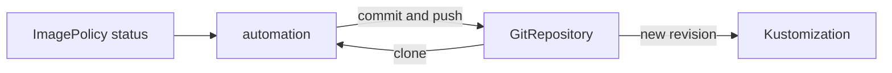

# ImageUpdateAutomation, Setters And Commits

The policy produces a tag. Something still has to write it into Git. In Flux that is the `ImageUpdateAutomation`, served by the image automation controller. This part explains how the controller finds the place to edit, how it commits and pushes, and how the result flows back into the cluster.

## What the automation does on each run

On every interval the controller does the following:

1. Clone the Git repository that the `sourceRef` names, on the branch from `git.checkout`.
2. Search the files under `update.path` for setter markers.
3. For each marker, read the status of the named ImagePolicy and replace the value in the file.
4. If any file changed, create one commit with the configured author and message.
5. Push the commit to the branch from `git.push`.

The `GitRepository` named in `sourceRef` supplies the URL and the credentials. Its Secret must allow pushes, because the same credentials are used to push. A read-only deploy key makes the push fail with a permission error in the status.



The diagram shows the automation reading the policy, writing to Git through the GitRepository, and the Kustomization picking up the new revision.

## Setter markers

A marker is a comment on the line that holds the value. It is written as JSON inside a comment.

```yaml
images:
  - name: ghcr.io/stefanprodan/podinfo
    newTag: 6.14.0 # {"$imagepolicy": "flux-system:scout:tag"}
```

The value after `$imagepolicy` has the form `namespace:name` and an optional suffix. The suffix selects which part of the policy result to write.

- No suffix writes the whole reference, such as `ghcr.io/stefanprodan/podinfo:6.15.0`. It fits a field that holds a full image.
- `:tag` writes only the tag.
- `:name` writes only the image name.
- `:digest` writes the digest, which fits a field that holds `sha256:...`.

The marker must sit on the same line as the value. Kustomize `images` entries, Helm values files and plain Deployment YAML all work, because the controller edits text by position and does not interpret the file.

## The automation object

```yaml
apiVersion: image.toolkit.fluxcd.io/v1
kind: ImageUpdateAutomation
metadata:
  name: scout
  namespace: flux-system
spec:
  interval: 1m
  sourceRef:
    kind: GitRepository
    name: scout
  git:
    checkout:
      ref:
        branch: main
    commit:
      author:
        name: fluxbot
        email: fluxbot@starfleet.local
      messageTemplate: 'Update image to {{range .Changed.Changes}}{{.NewValue}}{{end}}'
    push:
      branch: main
  update:
    path: ./overlays/staging
    strategy: Setters
```

The fields:

- `git.checkout.ref.branch` is the branch to read. If it is omitted, the branch of the GitRepository is used.
- `git.push.branch` is the branch to write. If it differs from the checkout branch, the commit goes to a separate branch, for example for a pull request that a person approves. This is the usual way to add review to automatic updates.
- `git.commit.messageTemplate` is a Go template. `.Changed.Changes` lists each change with `.OldValue` and `.NewValue`, and `.AutomationObject` names the automation. A good message states the old and new tag.
- `update.path` limits the search to a directory. Narrow paths make the run faster and the change set predictable.
- `update.strategy` is `Setters`, which is the only strategy.

## Status and the loop

The status of the automation holds `lastPushCommit` and `lastPushTime` after a push, and `lastAutomationRunTime` after every run. If no marker needs a change, the run creates no commit. This is what ends the loop: the pushed commit changes the file, the GitRepository fetches it, and the next run finds the value equal to the policy and stops. A loop would only occur if two writers disagree, for example an automation and a CI job that both set the tag, each undoing the other.

## What the engine sees

After the push, the GitRepository fetches the new commit on its interval, or sooner with a webhook Receiver. The Kustomization applies the new overlay, and the Deployment rolls to the new tag. The deployed image, the Git history and the policy status then agree. Compare the three when something looks wrong: the policy status shows what was chosen, the Git log shows what was written, and the workload shows what runs.

## Try it: let Flux commit

Save this as `automation-scout.yaml`:

<!-- astrona:playground:renew -->

```yaml
apiVersion: image.toolkit.fluxcd.io/v1
kind: ImageUpdateAutomation
metadata:
  name: scout
  namespace: flux-system
spec:
  interval: 1m
  sourceRef:
    kind: GitRepository
    name: scout
  git:
    checkout:
      ref:
        branch: main
    commit:
      author:
        name: fluxbot
        email: fluxbot@starfleet.local
      messageTemplate: 'Update image to {{range .Changed.Changes}}{{.NewValue}}{{end}}'
    push:
      branch: main
  update:
    path: ./overlays/staging
    strategy: Setters
```

Apply it:

```sh
kubectl apply -f automation-scout.yaml
```

Then check the result:

```sh
kubectl -n flux-system get imageupdateautomation scout -o jsonpath='{.status.lastPushCommit}'
kubectl -n starfleet-staging get deploy scout -o jsonpath='{.spec.template.spec.containers[0].image}'
```

Pull the repository from your machine and read `git log`. The newest commit is by `fluxbot`, and the marker is still in the file. Change `git.push.branch` to `image-updates` and apply again. The next commit lands on that branch and the cluster does not move until the branch is merged.

## Common mistakes

- A GitRepository Secret that is read-only, so the push fails.
- A marker on a different line from the value, or a marker with a policy name that does not exist.
- A policy that selects a tag the Kustomization cannot pull, so the Deployment stalls after the commit.
- Two writers for the same line.

## Check yourself

- Which object supplies the Git credentials to the automation?
- What does the suffix `:tag` change in a marker?
- Why does the automation stop after one commit?
