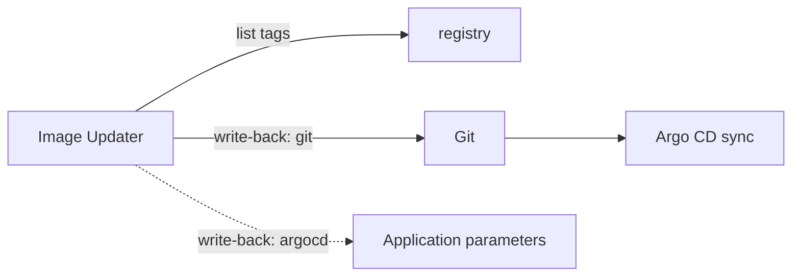

# Argo CD Image Updater, Safety And Choosing A Tool

Argo CD does not scan registries itself. A separate project, Argo CD Image Updater, does that job for Argo CD Applications. This part describes how it works, compares it with Flux image automation, and lists the practices that keep any automatic image update safe.

## Argo CD Image Updater

Image Updater runs as its own deployment, normally in the `argocd` namespace. On a schedule it does the following:

1. List the Applications it is told to watch.
2. For each watched image, query the registry for tags.
3. Apply an update strategy to choose the newest allowed tag.
4. If the tag changed, write it back.

The configuration depends on the version. Older versions are configured with annotations on each Application, with a list of images, an update strategy per image and a write-back method. Version 1.0 and later use a custom resource, `ImageUpdater`, that names the Applications and the images, so the configuration is no longer spread over annotations. Check the version in use before copying an example.

The update strategies are similar to the Flux rules: a semantic version constraint, the newest build by date, an alphabetical order, and a pinned digest that follows a mutable tag.

## Write-back methods

The write-back method is the most important setting, because it decides where the new tag is stored.

- The `argocd` method writes the tag into the Application as a parameter override, for a Helm or Kustomize source. Git is not changed. The Application object differs from Git, so the repository no longer shows what runs. If the Application is recreated from Git, the override is lost.
- The `git` method commits the tag to the Git repository, either to a file Image Updater writes (a `.argocd-source-<app>.yaml` file next to the source) or into the files themselves, and pushes. The repository keeps the history and Argo CD syncs the commit as it would any other.

For a GitOps design, the `git` method is the correct one, because Git remains the single source of truth. The `argocd` method is quick to set up and is useful for tests, with the cost that the state is not in Git.



The diagram shows the two write-back paths: a commit that Argo CD then syncs, and a direct change to the Application that bypasses Git.

## Comparing the two tools

- Flux image automation is part of the Flux toolkit and uses Flux objects: `ImageRepository`, `ImagePolicy` and `ImageUpdateAutomation`. It always writes to Git and uses markers in files.
- Argo CD Image Updater is a separate project from Argo CD. It can write to Git or to the Application, and it selects the target through Application configuration instead of markers.
- Flux separates scanning, choosing and writing into three objects, so each step has a status. Image Updater combines them in one configuration and reports through logs and Application annotations.
- Both need registry read access and, for Git write-back, repository write access.

The choice usually follows the engine already in use. A team on Argo CD uses Image Updater or the CI commit design. A team on Flux uses image automation.

## Practices for safe automatic updates

- Follow a range, not the newest tag. A range such as `6.15.x` allows patch updates and stops a major version from arriving unreviewed.
- Use automation for lower environments and a reviewed change for production. Write to a separate branch and merge it by pull request, or let a promotion job copy the tag.
- Pin by digest when tags are mutable. A digest in Git makes the running image match the commit.
- Make the commit message state the old and new tag, so the history reads as a change log.
- Keep one writer per line. If CI also edits the tag, the two writers conflict.
- Make rollback a Git operation. Reverting the bot commit puts the old tag back, but the automation then selects the newer tag again at the next run. To hold a rollback, suspend the automation or lower the range in the policy first.
- Watch the signals from the previous module: events for a failed push, and the status of the Kustomization after the commit.
- Verify what is pulled. Image signatures are checked by an admission policy or by Flux for OCI artifacts, so the automation does not need to trust the registry alone.

## Failure modes

- The registry is down or rate-limits the scan. The policy keeps its last result, and nothing changes. The status of the ImageRepository shows the error.
- The push is rejected because the branch is protected. The automation reports the Git error and retries on the next interval.
- A bad tag is published inside the allowed range. Every follower moves to it. A range cannot protect against a bad release, only against an unwanted version number.

## Try it: hold a rollback

Run these commands in the playground after the lab automation exists:

<!-- astrona:playground:renew -->

```sh
kubectl -n flux-system patch imageupdateautomation scout --type merge -p '{"spec":{"suspend":true}}'
kubectl -n flux-system get imageupdateautomation scout
```

The automation is suspended. Revert the newest bot commit in Git from your machine and push. The Kustomization applies the old tag and stays there. Resume the automation with `"suspend":false` and the next run moves the tag forward again. This shows why a rollback needs a decision about the rule as well as the commit.

## Common mistakes

- Choosing the `argocd` write-back and then treating Git as the record of what runs.
- Following the newest tag in production.
- Rolling back with a revert while the automation is still active.
- Giving the automation write access to every branch.

## Check yourself

- Which Image Updater write-back method keeps Git as the source of truth?
- Why should a rollback suspend the automation or change the policy?
- Which objects in Flux replace the single Image Updater configuration?
